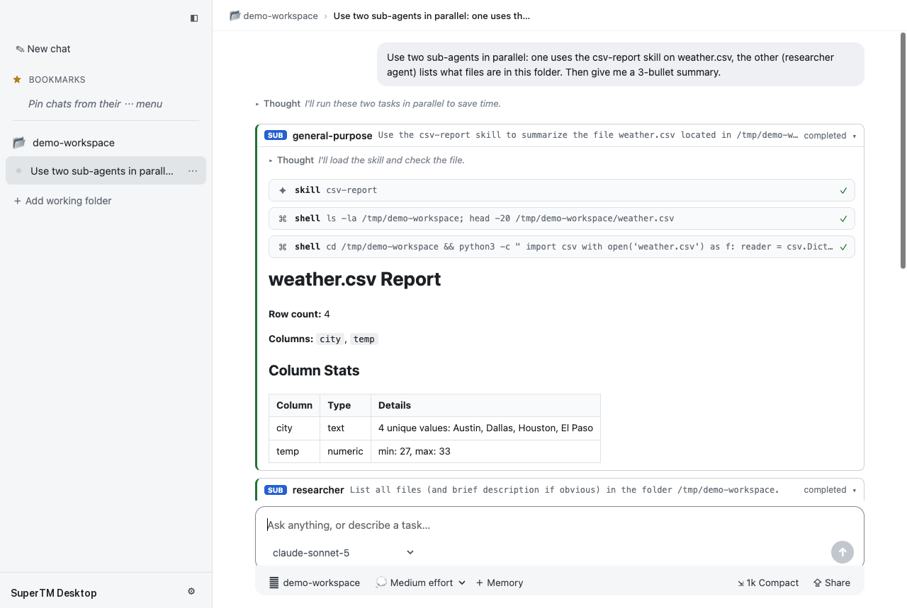
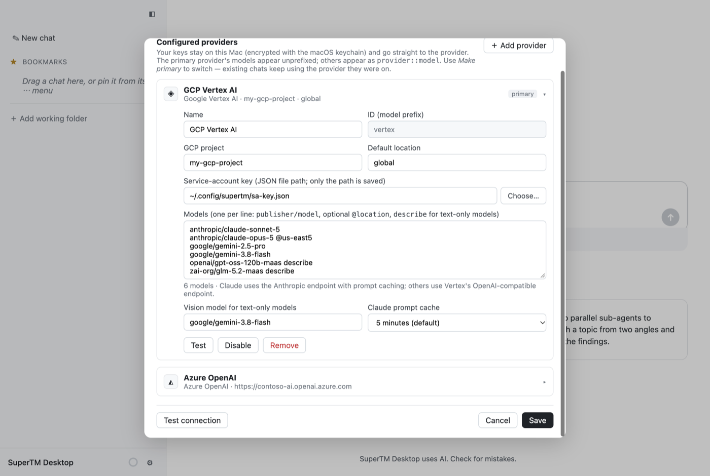

# SuperTM Desktop

**A lightweight, Copilot-style desktop agent for _your own_ models.**

SuperTM Desktop is a small macOS app that gives you a GitHub Copilot–like chat experience — a main agent that can call tools, load skills, and delegate to sub-agents — but pointed at the models you choose: **Google Vertex AI** (Gemini, Claude, Model Garden), **Azure OpenAI**, or **any OpenAI-compatible endpoint** (vLLM, Ollama, LiteLLM, a cloud gateway, …). No repo, git or PR features: just a prompt box, an agent, and your working folder.

It reads skills and agents from the same places Copilot does — `<folder>/.github/` and `~/.copilot/` — so an existing skill/agent library works out of the box.



## 🚀 Start here: the tutorial

> **New to SuperTM Desktop? Follow the illustrated [Getting-started tutorial](doc/tutorial.md).** It takes about 10 minutes and has a screenshot for every step.

| | Tutorial step |
|---|---|
| 1 | [Install the app](#install) |
| 2 | [Add a working folder](doc/tutorial.md#1-add-a-working-folder) |
| 3 | [Connect a model: **Google Vertex AI** example](doc/tutorial.md#example-a-google-cloud-vertex-ai) · [**Azure OpenAI** example](doc/tutorial.md#example-b-azure-openai-or-azure-ai-foundry) |
| 4 | [Chat with the agent](doc/tutorial.md#3-chat-with-the-agent) |
| 5 | [Skills and agents per folder](doc/tutorial.md#4-skills-and-agents-per-folder) |
| 6 | [Memory compaction](doc/tutorial.md#5-keep-long-chats-small-memory-compaction) · [AI usage and cost](doc/tutorial.md#6-see-what-you-spend-ai-usage) |
| 7 | [Move chats between Macs, or import from Copilot / Claude Code](doc/tutorial.md#7-move-chats-between-macs-sync-sessions) |

<a href="doc/tutorial.md"></a>

## Install

1. Download the `.dmg` for Apple Silicon from **[Releases](https://github.com/careychou/supertm-desktop/releases)** (see the [CHANGELOG](CHANGELOG.md)) and drag the app to Applications.
2. The app is signed ad hoc but not notarized by Apple, so the first time you open it macOS says it **can't verify the developer**. Click **Done**, then open **System Settings → Privacy & Security**, scroll to *"SuperTM Desktop" was blocked…* and click **Open Anyway** (once). Or skip the prompt with:
   ```bash
   xattr -cr "/Applications/SuperTM Desktop.app"
   ```
   Open the copy in **Applications**, not the one inside the disk image. If macOS says the app **is damaged and can't be opened**, you have a build from before 1.2.5 (missing signature): drag it to Applications and run the `xattr` command above, or download the latest release.
   After installing a new version, macOS may ask once for your **login password** so the app can read its saved keys (*"SuperTM Desktop wants to use your confidential information stored in 'SuperTM Desktop Safe Storage'"*). Enter it and click **Always Allow**. The app is signed ad hoc, so macOS treats each build as a new app and asks again after every update. If the window stays blank while the prompt is open, answer it and reopen the app.
3. Open it and continue with the [tutorial](doc/tutorial.md).

## What it does

- **Agent with tools**: shell, files, web fetch and SQL, run in **Autopilot** or **Interactive** (ask first) mode.
- **Parallel sub-agents** and visible model **thinking**.
- **Copilot-compatible skills and agents**, loaded from `<folder>/.github/` and `~/.copilot/`.
- **Your models**: Google Vertex AI (Gemini, Claude, Model Garden), Azure OpenAI or AI Foundry, or any OpenAI-compatible endpoint.
- **Chats organized by working folder**, with forks, bookmarks and drag & drop.
- **Attachments**: images and documents, compressed automatically.
- **Memory compaction**, shareable exports, and **session + folder memory** (notes and files shared by one chat or every chat in a folder).
- **AI usage and cost** for this app, your GCP project, or your Azure resource.
- **Sync sessions** between Macs, and import chats from GitHub Copilot or Claude Code.

## Documentation

| Doc | For |
|---|---|
| [Tutorial](doc/tutorial.md) | **Start here.** Step-by-step setup and use, with screenshots |
| [Provider setup](doc/provider-setup.md) | Vertex, Azure and custom endpoints in full detail, with troubleshooting |
| [Feature reference](doc/features.md) | Every feature in detail: tools, sub-agents, attachments, compaction, usage, data location |
| [Technical docs](doc/README.md) | How it works inside: agent framework, memory compaction, algorithms |

## Build from source

Requires Node 22.5+ (for `node:sqlite`) — tested with Node 25.

```bash
git clone https://github.com/careychou/supertm-desktop.git
cd supertm-desktop
npm install
npm run dev            # hot-reload dev mode
npm test               # vitest: engine, tools, registry, adapter, compaction, export
npm run dist           # → dist/supertm-desktop-<version>-arm64.dmg / .zip
npm run dist:dir       # → dist/mac-arm64/SuperTM Desktop.app (fast, unpacked)
```

### Headless CLI (same engine)
```bash
npm run cli -- --models
npm run cli -- --cwd ~/my-project --model my-model -p "list the skills you have"
npm run cli -- --yes -p "..."   # auto-approve shell and file writes
```

## Project layout
```
src/engine/    headless agent engine: adapter, registry, tools, loop, sub-agent manager, session, compaction
src/cli/       terminal runner
src/main/      Electron main: settings (safeStorage), SQLite store, IPC
src/preload/   contextBridge API
src/renderer/  React UI
src/shared/    fork/tree, export and usage/pricing helpers shared by main + renderer
doc/           technical docs (agent framework, memory compaction, algorithms), history/ (original MVP spec + plan), images/
```

## Status

Early, personal project (v0.1). macOS / Apple Silicon is the only packaged target. Issues and PRs welcome.

## License

[MIT](LICENSE)
