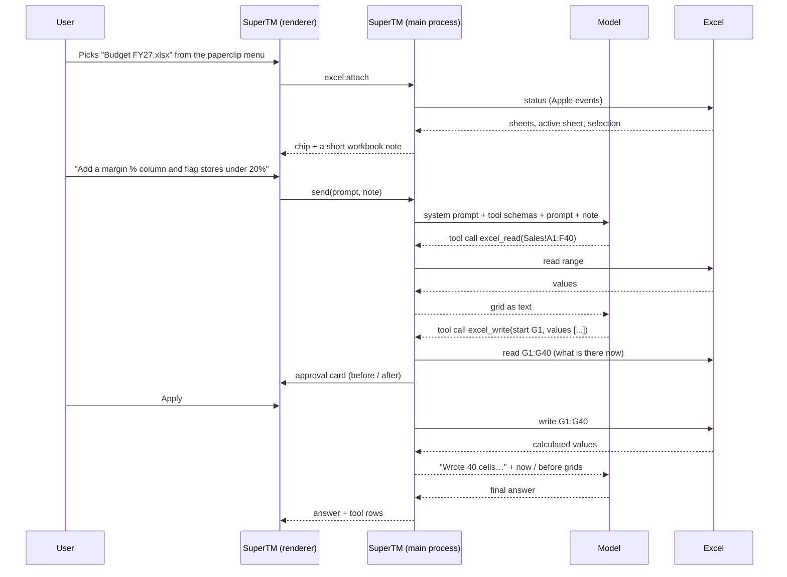

# Excel: how it works

SuperTM Desktop reads and edits Excel workbooks without an Excel add-in. This page explains the mechanics: how the app reaches Excel, what travels between the app and the model, and where the safety checks sit. For how to use it, see the [tutorial](tutorial.md#work-with-excel).

## The short version

- The model never sees Excel. It sees four tools (`excel_info`, `excel_read`, `excel_write`, `excel_format`) and gets cells back as text.
- A workbook **open in Excel** is edited *live*: the app sends Apple events to the running Excel, so the change appears on screen and Excel recalculates.
- A **closed `.xlsx` file** is edited *on disk* with a library, with no Excel involved.
- The same tool call works for both. The app decides which path to take from the `workbook` argument.
- No screenshots and no mouse control are involved, which is why it is fast and cheap: one tool call returns thousands of cells as exact text.

## The pieces

| Piece | File | Job |
|---|---|---|
| Tools and routing | `src/main/excel/service.ts` | Defines the four tools, picks live or file, asks for approval, makes backups, formats the result text |
| Live backend | `src/main/excel/live.ts` | Talks to the running Excel through `osascript` |
| File backend | `src/main/excel/file.ts` | Reads and writes `.xlsx` with the `exceljs` library |
| Shared helpers | `src/shared/excel.ts` | A1 range maths, the grid text format, the workbook note. Pure code, used by the main process, the renderer and the tests |
| Wiring | `src/main/excel/index.ts` | Registers the tools and two IPC calls (`excel:status`, `excel:attach`) |
| Chat UI | `src/renderer/src/components/ExcelViews.tsx` | Draws cell grids in tool rows and the approval card |
| Composer and Settings | `Composer.tsx`, `SettingsModal.tsx` | The paperclip menu, the workbook chip, and Settings → MS Office (shared with Word and PowerPoint) |

Everything Excel-specific runs in the Electron **main process**. The renderer only displays results and asks for status.

## One request, end to end

The model and Excel take turns through the app's normal tool loop (`src/engine/loop.ts`). Nothing about the loop is special to Excel.



Step by step:

1. **Attach.** When the user picks an open workbook, the app asks Excel for its sheets, used ranges, active sheet and current selection, and builds a *workbook note*. The note is a few lines of text, not the data. Just before sending, the app asks again, so the note carries the selection at that moment ("follows your selection").
2. **Send.** The note rides along as an attachment. The request to the model also carries the four tool schemas and a short paragraph in the system prompt telling the model to prefer these tools over scripts or screenshots.
3. **The model asks for cells.** It replies with a tool call such as `excel_read {"workbook":"Budget FY27.xlsx","range":"Sales!A1:F40"}`.
4. **The app runs it** and returns the cells as text (format below). The model now has exact values.
5. **The model asks to write.** For example `excel_write {"start":"G1","values":[["Margin %"],["=(E2-F2)/E2"], …]}`.
6. **The app reads the target range first**, so it can show the user what will be replaced and hand the old contents back to the model.
7. **Approval.** In an Interactive chat the user sees a card with the new cells and any cells being replaced, and chooses Apply, Apply all, or Skip. Autopilot chats skip the card.
8. **Write, then read back.** After writing, the app reads the same range again and returns what the cells hold now, with formulas already calculated.
9. **Repeat** until the model answers without a tool call.

**Order is kept.** A model often issues several tool calls in one step, for example a write and then a format that depends on it. The engine starts tool calls in parallel, so the Excel service queues its own calls and runs them one at a time in the order they were issued (`serial` in `service.ts`). Without that, the second call could read the sheet before the first had landed, which is what happened in testing.

Each tool call is one model round trip. A typical edit is two to four: read, write, perhaps format, then the answer.

## What the model sees

### The workbook note (on attach)

```
This workbook is open in Excel right now. Use the excel_* tools with workbook "Budget FY27.xlsx"; edits appear live and Excel recalculates.
Path: /Users/me/work/Budget FY27.xlsx
Sheets: Sales (used A1:F40), Notes (used A1)
Active sheet: Sales
The user's current selection: Sales!B2:F40. "This", "these cells" or "here" in the prompt mean this selection.
```

### A read result

A summary line, then a tab-separated grid with column letters on the first line and the row number at the start of each row:

```
Budget FY27.xlsx (live) · Sales!A1:C3 · 3 rows × 3 columns
--- values ---
	A	B	C
1	Store	Week	Units
2	S002	3	310
3	S003	3	244
```

The row and column labels let the model refer to cells by address without counting. The chat UI parses the same text to draw the grid (`parseGrid` in `src/shared/excel.ts`), so the user and the model look at the same thing.

With `formulas: true` a second section, `--- formulas ---`, gives each cell's formula.

### A write result

```
Wrote 39 cells (39 formulas) to Sales!G2:G40 in Budget FY27.xlsx (live).
The workbook is changed in Excel but not saved; the user saves it.
--- now ---
	G
2	0.24
3	0.16
The cells were empty before.
```

When cells were replaced, a `--- before ---` section holds their previous contents (formulas as formulas) and a line telling the model it can write that block back to undo the change.

### Limits that keep requests small

| Limit | Value |
|---|---|
| Cells returned per read | 5,000 by default, up to 50,000 with `max_cells`. Rows are cut, never columns, and the result names the range to ask for next |
| Tool result size | 60,000 characters |
| Cells per write | 200,000 |
| Read-back after a write | First 240 cells |
| Approval preview | First 8 rows × 6 columns |

## The live path: talking to a running Excel

The app runs `osascript -l JavaScript` with one fixed script (JavaScript for Automation). The script uses Excel's own scripting dictionary, the same one AppleScript uses.

- **One process per tool call.** The request is written to a temporary JSON file, because a large block of values does not fit on a command line. The script reads it, does the work, and prints one JSON answer. In testing a call took roughly 0.3 to 1.3 seconds.
- **It never launches Excel.** The app checks that Excel is running first (`pgrep`), and the script checks again before sending anything.
- **Finding the workbook.** By name (case-insensitive) or by full path. With no `workbook` argument it uses the active workbook.
- **Finding the sheet.** By name; with none given, the active sheet when the workbook is the active one, otherwise the first sheet.
- **Reading.** One call fetches the whole range's values. Dates become `YYYY-MM-DD` text. Error cells come back empty over Apple events, so when a formula cell is empty the script also fetches the displayed text and returns that (`#DIV/0!`, `#N/A`).
- **Writing.** One call sets the whole range. Excel treats each string as if it were typed, so `"=SUM(E2:E40)"` becomes a formula and `"2026-11-17"` becomes a date. The app protects IDs: a string of digits with a leading zero, or longer than 15 digits, is sent with a leading apostrophe so Excel keeps it as text.
- **New sheets.** `create: true` adds the sheet. Excel makes a new sheet the visible one, so the script switches back to the sheet the user was on.
- **Formatting.** Fill, font colour, bold, italic, number format and column autofit, through the range's `interiorObject`, `fontObject` and `numberFormat`.
- **Conditional highlighting is decided by the app, not the model.** `excel_format` takes `only_if` (for example `"<0.2"`, `">=100"`, `"=Closed"`, `"blank"`). The app reads the range, tests every cell itself, and formats only the matches; `whole_row: "A:G"` widens each match to those columns of its row. In testing, a model asked to pick the rows under 20% by reading 39 values got one wrong; with `only_if` the selection is exact. The same logic runs on the file path.
- **Nothing is saved.** A live edit changes the workbook in Excel and leaves saving to the user.

### macOS permission

Controlling another app needs the user's consent under macOS **Automation** privacy. The first time the app talks to Excel, macOS asks "SuperTM Desktop wants access to control Microsoft Excel". The app's `Info.plist` carries `NSAppleEventsUsageDescription` so that prompt can appear.

The app does not trigger that prompt on its own. Checking whether Excel is installed or running uses the file system and `pgrep`, which need no permission. The first Apple event is sent only when the user opens the paperclip menu, presses **Check Excel connection** in Settings, or a tool runs.

If the user declined, calls fail with error `-1743`. The app turns that into a message pointing to System Settings → Privacy & Security → Automation.

### When Excel cannot answer

| Situation | What the model is told |
|---|---|
| Excel is not running | Falls back to the file if `workbook` is a path that exists; otherwise says to pass a path |
| Workbook not open | Falls back to the file if it exists; otherwise lists the open workbooks |
| Sheet not found | Lists the sheets in that workbook |
| Permission not granted | The Automation message above |
| A cell is being edited, or a dialog is open | After 60 seconds: "Finish editing the cell or close any open dialog in Excel, then try again" |

## The file path: editing a closed `.xlsx`

For a workbook that is not open, the app uses [`exceljs`](https://github.com/exceljs/exceljs) in the main process. It loads the file, changes cells, and writes it back.

- **Only `.xlsx`.** Other formats are refused with advice to open the workbook in Excel and edit it live.
- **Formulas are stored, not calculated.** Nothing on this path can evaluate a formula. The file is flagged to recalculate when Excel next opens it, and a read before then reports that some formulas have no value yet.
- **Typed-in behaviour is matched.** A numeric string becomes a number and an ISO date becomes a date, the same as the live path, so the two modes give the same workbook. A leading apostrophe forces text.
- **Shared formulas are unpacked.** Excel stores a filled-down column as one shared formula. Before writing into a sheet, the app turns each into its own formula so a write in the middle cannot orphan the rest.

Two guards stop a file edit from damaging a workbook:

1. **Content the library cannot carry.** `exceljs` drops charts, pivot tables, macros, slicers, drawings and links to other workbooks when it saves. The app lists the file's parts first and refuses to write if any are present, telling the model to open the workbook in Excel and edit it live.
2. **A copy open in Excel.** Excel leaves a `~$name.xlsx` lock file beside an open workbook. If it is there and the live path is not available, the app refuses, because writing the file would conflict with the open copy.

## Choosing live or file

Every tool call goes through one routing function (`route` in `service.ts`):

1. If Excel is running, try the live path with the `workbook` argument as both a name and a resolved path.
2. If Excel answers "not open" and the path exists on disk (or the call may create it), use the file path.
3. If Excel is not running, use the file path.
4. If permission is missing, use the file path only when the file is not locked by Excel.

So `"Budget FY27.xlsx"` means the open workbook when it is open, and the file in the working folder when it is not. The result always says which was used: `(live)` or `(file)`.

## Safety around writes

| Mechanism | Detail |
|---|---|
| Approval | A write or format in an Interactive chat raises a permission request of kind `excel`. Its detail is JSON (`ExcelPreview`): the range, a summary, and before / after grids. The renderer draws it as a card. "Apply all Excel changes in this chat" remembers the answer for the session and also answers any Excel requests already waiting (the model can issue several tool calls at once). Autopilot, or Settings → MS Office → "Apply without asking", skips it |
| Reads never ask | Only `excel_write` and `excel_format` are gated |
| Backup | Before the first edit of a workbook in an app run, the file is copied to `name.backup.xlsx` beside it. For a live workbook this is the last *saved* version. Skipped for workbooks that were never saved or live on OneDrive/SharePoint URLs |
| Old contents returned | A write result includes what the cells held before, so "undo that" is one more tool call |
| Declining | If the user chooses Skip, the tool returns an error and nothing is written, and no backup is made |

Whether Excel's own Undo (⌘Z) reverses a scripted edit has not been verified. The backup and the returned "before" block are the supported ways back.

## Attaching a workbook

There are two kinds of chip:

- **Live** (from the paperclip menu): sends only the workbook note. The model reads what it needs with the tools.
- **File** (a dropped or attached `.xlsx`): the existing behaviour is kept, so the file's text is inlined (trimmed to the document limit). In addition the attachment notes the file's path, so the model can read more of it or edit it with the tools.

## Settings

Stored in `settings.json` alongside the other settings:

| Key | Default | Meaning |
|---|---|---|
| `excelEnabled` | `true` | When off, the tools and the prompt paragraph are not sent to the model at all |
| `excelConfirm` | `ask` | `ask` shows the approval card; `never` applies without asking |
| `excelBackup` | `true` | Make `name.backup.xlsx` before the first edit |

Settings → MS Office is one tab for Excel, Word and PowerPoint. Its on/off choice sets `excelEnabled` and `officeEnabled`; its ask-first and backup choices write the Excel key and the matching Word and PowerPoint key together. **Connect to Office** asks both services for their status in one press.

Idle chats are rebuilt when Settings are saved, so a change takes effect on the next message.

## Scope and known gaps

- **macOS only** for the live path. The file path has no platform dependency beyond `unzip` for the content check.
- **Sub-agents do not get the Excel tools.** Only the main agent of a chat does.
- **No charts, pivot tables or Excel conditional-formatting rules** through the tools. Highlighting is a static fill: it does not update when the values change later.
- **Multi-area and whole-column selections** are passed to the model as Excel reports them; the tools themselves take rectangular ranges (formatting accepts several, comma-separated).
- **Updates and the permission.** Builds are ad-hoc signed. In testing, installing a new build over the old one kept the Automation permission; if macOS ever asks again after an update, allowing it once restores the connection.

## Tests

`tests/excel.test.ts` covers the range and grid helpers, the file backend end to end (create, read back, format, backup, the two guards), and the routing and approval logic against a fake Excel. The live backend itself needs a running Excel and is checked by hand: open a workbook, attach it, and ask for an edit.
