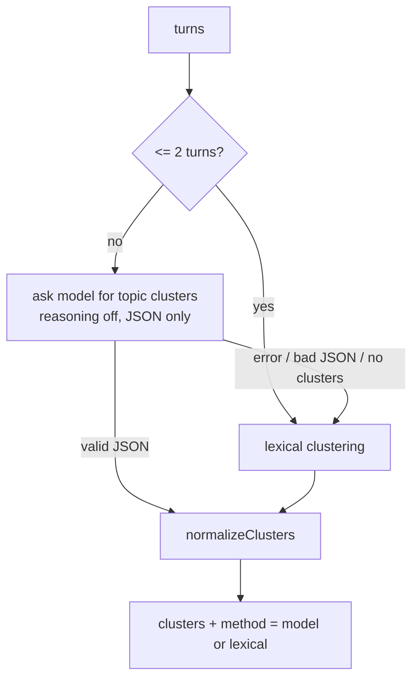
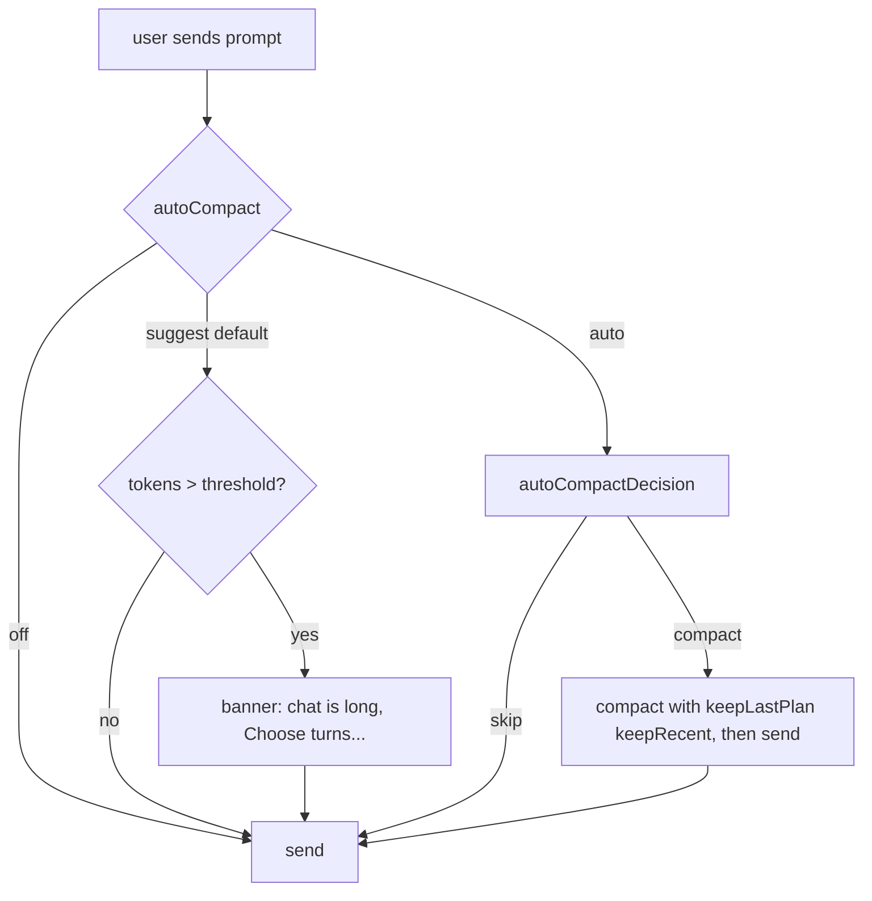

# Memory compaction

Long chats outgrow the model's context window and get slower and more expensive on every request (the whole history is re-sent each time). Compaction replaces old history with a compact summary **plus** the turns you choose to keep verbatim, so the agent keeps the important facts without carrying every message.

Source: `src/engine/compact.ts` (algorithms and the auto-compact policy), `Session.compact` in `engine.ts`, orchestration in `src/main/index.ts` (`compactSession`, auto-compact in `run`), UI in `CompactModal.tsx`, turn mapping in `src/shared/fork.ts`.

## 1. Design goals

1. **Never silently lose something the user cares about.** The user can see exactly which turns will be kept, summarized and dropped before anything happens.
2. **Keep recent work exact.** Recent turns stay verbatim, including their tool calls and results, so the agent can continue mid-task.
3. **Compaction must be repeatable.** Compacting a compacted chat merges the old summary into the new one instead of summarizing a summary of a summary.
4. **Survive failures.** If clustering or the model fails, the feature degrades (keyword clustering) rather than breaks. History is replaced only after a summary has been produced.
5. **Keep the UI and the forks consistent** even though the model-facing history no longer matches what the user scrolls through.

## 2. Vocabulary

| Term | Meaning |
|---|---|
| **Turn** | A "real" user message plus everything up to the next real user message: assistant messages, tool calls, tool results, notifications. The atomic unit of compaction. |
| **Real user message** | A user message that is not a `<system_notification>` (background-agent notice) and not the `<compacted_history>` summary message. This keeps one user prompt and all the agent work it triggered together, and stops injected messages from creating bogus turns. |
| **Plan** | `{ keep: number[], summarize: number[] }` of turn indexes. |
| **Live history** | The model-facing `messages[]` (after the system prompt). |
| **UI turn** | A turn as shown in the chat. After compaction, live turns map onto UI turns through the turn map (§8). |

## 3. The plan: keep, summarize, drop

Every turn is in exactly one bucket:

| Bucket | Result |
|---|---|
| **keep** | Stays verbatim in the history. |
| **summarize** | Read by the summarizer; its content survives only as part of the summary. |
| **drop** (in neither list) | Removed completely, not summarized. |

If a turn is in both lists, **keep wins** (`planTurns`). Two ways to build a plan in the UI:

- **Keep the last N** (`keepLastPlan(n, k)`): keep the last `k` turns, summarize everything before. This is the default and what auto-compaction uses.
- **Choose turns:** per-turn Keep / Summarize / Drop, with topic **clusters** to speed it up (§5). "Choose" mode starts from whatever "keep last N" currently means so switching modes never changes the selection unexpectedly.

If nothing would be summarized or dropped, nothing happens.

## 4. Token estimation

Used for the "this chat is long" banner, the auto-compact trigger and the before/after numbers.

```
tokens ≈ JSON.stringify(message).length / 4        (per message, summed)
image content part  = 1600 tokens flat             (IMAGE_TOKENS)
```

Chars/4 is a deliberately cheap, tokenizer-free approximation that is good enough for threshold decisions. Images are counted flat instead of by their base64 size, which would overstate them by orders of magnitude (provider vision costs depend on resolution, not on base64 bytes).

## 5. Clustering related turns (`clusterTurns`)

Purpose: in long chats the topic often pivots and returns ("data question → UI fix → back to the data question"). Selecting by *topic* is more natural than by position, so the picker recommends groups of related turns.



**Model clustering.** The model receives a digest of each turn: `[n] USER: <400 chars> / ASSISTANT: <400 chars of the final answer> / TOOLS: names`. It is asked to group turns by topic, allowing non-adjacent turns, every turn in exactly one cluster, with a 2–5 word label and a one-line reason, and to reply with JSON only. The JSON object is extracted from the first `{` to the last `}` so stray prose or code fences do not break parsing.

**Lexical fallback** (deterministic, no model call):

1. Each turn becomes a keyword set from `user + user + answer` (the user text is counted twice so the question outweighs boilerplate in the answer). Keywords are lowercase tokens of ≥3 chars matching `[a-z][a-z0-9_-]`, stop words removed.
2. Single-link clustering with union-find: two turns are merged when the **Jaccard similarity** of their keyword sets is ≥ 0.12 (`|A∩B| / |A∪B|`). Single-link means similarity chains: A~B and B~C puts A, B, C together even if A and C share little.
3. A cluster's label is its three most frequent keywords.

**`normalizeClusters`** makes the output safe whichever path produced it: drops indexes that do not exist, keeps only the first occurrence of duplicates, adds every missed turn as a singleton cluster, and sorts clusters by first turn. The UI can therefore rely on every turn appearing exactly once. The method (`model` or `lexical`) is shown to the user ("Related turns (AI)" vs "(keywords)").

Clusters are advisory: the user can still change each turn individually.

## 6. Summarization (`summarizeTurns`)

Only the **summarize** bucket is sent to the model, as a transcript with per-field clipping so one huge tool result cannot dominate:

| Field | Clip |
|---|---|
| User message | 8,000 chars |
| Assistant text | 6,000 chars |
| Tool-call arguments | 600 chars |
| Tool result | 1,500 chars |
| Notifications | 800 chars |

Clipped text ends with `…`. The transcript is labelled `### Turn n`, `USER:`, `ASSISTANT:`, `TOOL CALL name:`, `TOOL RESULT:`, `NOTIFICATION:`.

**What the summarizer is told to retain** (the system prompt frames it as "working memory for an AI agent that will continue the conversation"):

- the user's goals and preferences
- key facts and numbers
- decisions **and their reasons**
- files, paths and commands that matter
- results of tool runs
- open questions and next steps

and to *group by topic*, omit pleasantries and dead ends unless they explain a decision, and "be concise but lose nothing important". Output is dense Markdown.

An empty summary throws, so a failed call can never wipe the history.

**Why these choices.** Tool results are large and mostly noisy, but they carry the *evidence* for decisions, so they are clipped, not removed. User messages get the largest budget because they hold the intent. Tool-call arguments are kept short because the intent is visible in the assistant text and the result.

### Incremental merge (summary of a summary)

If the history already starts with a `<compacted_history>` message, `priorSummary()` extracts it and the prompt prepends:

```
Existing summary of even earlier history (merge it in):
<previous summary>
```

The model produces **one** merged summary, so earlier memory is carried forward and repeated compaction does not stack nested summaries. Because the new summary is rewritten each time, details that were already thin can fade over many compactions; the user's *kept* turns and the `compact` marker in the UI keep the audit trail.

## 7. Building the new history (`applyCompaction`, pure)

```
before:  [turn0][turn1][turn2][turn3][turn4]            plan: keep [3,4], summarize [0,1], drop [2]
summary = summarize(turn0, turn1, merge(prior summary))
after:   user:  <compacted_history> Summary of the earlier conversation ... </compacted_history>
         assistant: "Understood. I have the summary of the earlier conversation and will build on it."
         [turn3][turn4]                                  (verbatim, original order)
```

- The summary is a **user** message followed by a fixed assistant acknowledgement so the conversation alternates correctly for every provider, and so the model treats the summary as shared context rather than as an instruction.
- The system prompt (index 0) is untouched; `Session.compact` splices the new history in after it.
- Kept turns are copied unchanged, so tool-call / tool-result pairs inside them remain valid.
- Kept turns need not be contiguous (e.g. keep turns 1 and 4, summarize 2–3).
- If the summary is empty (everything kept or dropped) no summary message is added.
- Compaction is refused while the chat is busy (`session is busy`).

## 8. The turn map: keeping the UI and forks consistent

After compaction the live history has fewer turns than the chat shows. `sessions.turn_map` (a JSON array) records, for each live turn, the UI turn number it came from:

```
UI turns:   0 1 2 3 4 5 6           compact keep [1, 5, 6]
turn_map:   [1, 5, 6]               live turn 0 = UI turn 1, live 1 = UI turn 5, ...
new turn:   liveTurnMap extends     → [1, 5, 6, 7, 8, ...]
```

`liveTurnMap(count, map, offset)` extends the stored map for turns added after the compaction (consecutive numbering from the last mapped value). An older `compact_offset` form (all turns before an offset were removed) is still understood.

It is used for:

- **Forking** a chat at a UI turn: the fork keeps the live turns whose UI number is ≤ the chosen turn (`map.filter(u => u <= turn)`), copies the summary (it is part of the live history) and gets an adjusted map.
- **UI markers**: after compaction the `compact` item inserted into the thread records the kept, summarized and dropped UI turn numbers (`keptTurns`, `summarizedTurns`, `droppedTurns`), a before/after token count and the summary text, so users can read what the agent now "remembers".

The user-visible transcript (`ui_items`) is never rewritten, only annotated: you can still scroll through the old conversation, but the model no longer sees it.

## 9. When compaction runs



All of these live in **Settings → Memory compaction**:

| Setting | Default | Meaning |
|---|---|---|
| `autoCompact` | `suggest` | `off`, `suggest` (banner only) or `auto` |
| `compactThreshold` | 80,000 tokens | Estimated size above which a chat is a candidate (banner / auto) |
| `compactKeepRecent` | 2 | Turns kept verbatim by auto-compaction |
| `compactModel` | `''` = the chat's model | Model for summaries and topic clustering |
| `compactIdleMinutes` | 5 | Auto: wait until the chat's last model call is at least this old (0 = no wait) |
| `compactHardLimit` | 120,000 tokens | Auto: compact even when the cache is warm at or above this size (0 = never override the wait) |
| `compactMinGain` | 20,000 tokens | Auto: skip unless at least this much would be folded into the summary |

Auto-compaction runs *before* the new prompt is sent and uses the simple keep-last-N plan (no clustering call) so it adds only one model call. If it fails (e.g. the endpoint is down) an `Auto-compact failed: …` error is shown, the history is left untouched (it is only replaced after a summary exists) and the prompt is still sent. Manual compaction goes through the dialog: choose mode, review the buckets, see the before/after estimate, confirm. Manual compaction is never blocked by the auto rules: you decide.

### 9.1 Compaction and the prompt cache (why auto waits)

Providers cache the *prefix* of a request. With Claude (via the Vertex adapter's cache breakpoints) a cached prefix is read at ~0.1× the input price, writing it costs ~1.25×, and an entry lives ~5 minutes after its last use. Compaction **rewrites the beginning of the history**, so the next request after compacting cannot reuse the old cache: it pays one cache write on the new, shorter prefix. That is the whole cost; it does not "break" anything for later turns.

Worked example, 100k-token chat compacted to 20k, Claude input price *p* per token:

| | Per turn after this point |
|---|---|
| Not compacted, cache warm | 100k × 0.1*p* = **10k*p*** (cache read) |
| Compacted | 20k × 0.1*p* = **2k*p*** (cache read), after a one-time 20k × 1.25*p* = 25k*p* write + the summarize call |

The compacted chat saves ~8k*p* per turn against a warm cache. The one-time cost is the 25k*p* write plus the summarize call, which reads up to ~80k tokens of (clipped) transcript:

- summary on the **same model** (~80k*p* input + output) → ~105k*p* one-time → break-even after **~13–15 turns**;
- summary on a **cheap compaction model** (e.g. ~1/10 the price) → ~33k*p* → break-even after **~4 turns**;
- if the cache had **already expired**, the uncompacted chat would itself pay a full 100k write on the next turn, so compacting is ahead immediately.

That is why the defaults pair an idle wait with a separate, cheaper compaction model. Compacting is therefore the right call for long chats you keep using. It is wasteful when:

- the chat is about to end anyway (the write is never earned back);
- it is done every few turns on small gains (each compaction pays a new write and a summary call for little reduction);
- the cache is warm and you are in a rapid back-and-forth (you throw away a cheap 0.1× prefix right now).

`autoCompactDecision` (pure, in `compact.ts`) encodes exactly that:

```
gain = estimated tokens of the turns that would be summarized (all but the last keepRecent)
compact  iff  mode = auto
         and  tokens > threshold
         and  gain ≥ minGain                         (skip small, frequent compactions)
         and  ( tokens ≥ hardLimit                    (too big: context limit and per-turn cost win)
                or idleMinutes = 0
                or now − lastModelCall ≥ idleMinutes ) (cache already cold: compaction is free of cache loss)
```

`lastModelCall` is tracked in memory per chat from the main and sub-agent usage events (not from compaction's own calls), and falls back to the chat's `updated_at` after an app restart. A skipped decision is silent; the banner still offers manual compaction. The decision returns a reason (`cache-warm`, `small-gain`, `hard-limit`, `idle`, …) that the tests assert.

### 9.2 Compaction model

Summarizing is an extraction task; a fast, cheap model does it well, so `compactModel` lets you send summaries and clustering to a different model than the chat (e.g. Gemini Flash while chatting with Claude Opus). The chat's own cache is unaffected: the summarize call is a separate request with its own prefix. If the compaction model fails (not offered by the current provider, quota, network) `Session` retries once with the chat's model, so compaction never fails just because of this setting. Compaction calls are recorded in the usage ledger under the agent id `compact`, so their cost shows in **AI usage**; the compaction card shows which model wrote the summary.

## 10. What is kept and what is lost

| Kept exactly | Kept approximately | Lost |
|---|---|---|
| Turns in **keep** (messages, tool calls and results) | Content of **summarize** turns, as written by the model | Content of **drop** turns |
| System prompt, skills list, attached memories (they are in the system message, outside the history) | Earlier summaries (merged, can fade over many rounds) | Raw tool output beyond the clip limits in summarized turns |
| The full UI transcript | | Attachments (images/documents) inside summarized or dropped turns, other than what the summary says about them |

Practical advice: keep the turns that contain the *current task state* (files being edited, a half-finished plan), and let finished side topics be summarized.

## 11. Trade-offs and known limits

- **Summaries are lossy and model-written.** A summarizer can omit a detail or state one with false confidence. Mitigation: the prompt asks for decisions with reasons and specifics (paths, numbers, commands), the summary is shown to the user, and verbatim keep is always available.
- **chars/4 is approximate.** It can be off by ±30% (code and non-English text tokenize denser). Thresholds are therefore conservative defaults, not precise limits.
- **Cost:** one model call (plus one optional clustering call) on the compaction model, and one prompt-cache write on the next chat request (see 9.1). The summarize call is bounded by the clipping limits, so cost scales with the number of turns summarized, not their raw size.
- **Single-link lexical clustering** can chain unrelated turns through a common word; that is why clusters are advisory and shown with labels.
- **No semantic search over dropped content.** Dropped turns are gone from the model's view; only exports (see algorithms-and-internals.md) preserve them outside the chat.
- **Sub-agent transcripts** are never in the live history (only their final result inside the parent's `task` tool result), so they add nothing to compact.

## 12. Tests

`tests/compact.test.ts` covers turn splitting (notifications and summary messages do not start turns), plan semantics (keep wins), normalization (duplicates, unknown indexes, leftovers), lexical clustering, incremental merge via `priorSummary`, `applyCompaction` ordering, `Session.compact` with non-contiguous keep/summarize/drop sets, the compaction model (usage events and fallback to the chat model) and every branch of `autoCompactDecision`. `tests/fork.test.ts` covers fork slicing, the live turn map and ordering helpers.

## 13. Recall: searching turns after they are compacted

Compaction shortens what the model sees. Recall keeps what was removed findable. The code is in `src/engine/recall.ts` (pure logic and the tool) and `src/main/store.ts` (the index).

**Index.** Table `turn_index` holds one row per UI turn: the prompt (up to 2,000 characters), the final answer (up to 4,000), the names of the tools used, and a timestamp. Raw tool output, attachments and hint blocks are not stored. An FTS5 table `turn_fts` (`porter unicode61`) is kept in step by triggers. Rows are keyed by session and by the 0-based UI turn number taken from the turn map (§8), so a row keeps its number when earlier turns are removed.

**When it is written.** After every completed run, just before a compaction (so the turns about to be removed are captured), on fork (rows up to the fork turn are copied), and in the background at startup and after an import for chats with no rows. That background pass also reads the saved transcript, so turns that were compacted before recall existed are indexed too (existing rows are never replaced). Indexing a chat again skips unchanged rows and never deletes the rows of removed turns. Deleting a chat deletes its rows.

**The `recall` tool.** `recall(query, scope, limit, chat)`: `scope` is `session` (default), `folder` (chats with the same working folder) or `all`; `limit` is 5 by default and 10 at most. `chat` is the name, or part of the name, of another chat: the search then covers the chats with that name in any folder and `scope` is ignored. An exact name wins over partial matches; when no chat has that name the tool returns the recent chat names so the model can retry. The model takes the name from the prompt or from the session memory. The query is split into terms, common words are dropped, and the terms are joined with OR and ranked by BM25. A hit that is still in the live history is returned as a short pointer; any other hit is returned in full. A `# Recall` section in the system prompt says when to use it. The tool needs no permission because it reads only the app's own database.

**Compaction note.** When recall is available, `applyCompaction` adds a `<recall_note>` after the summary with the total number of removed turns (`removedCount` adds up earlier notes on a repeated compaction).

**Hints.** With the `recallHints` setting on, each new prompt is searched against the folder's chats (12 candidates). A candidate is kept only if at least two prompt terms and at least half of the prompt's terms appear in it; at most four are kept; the last 20 live turns of the current chat are skipped. The kept ones are attached as one line each in a `<recall_hints>` block **after** the prompt and attachments. The cached prefix is therefore unchanged. The block is stripped when turns are split for compaction, for the index and for text-to-speech.

**Limits.** Search is by keyword, so a question worded differently from the original turn can miss; an empty result tells the model to try other keywords. Tool output is not indexed. The CLI has no store, so it has no recall.

## 14. Recall: a live capture

This section is one real run through the app with a live model, showing the requests it sends before compaction, during compaction and for recall with the **Recall hints** setting off and on.

| | |
|---|---|
| App | SuperTM Desktop 1.4.4, commit `5506b30`, Electron 45.3.2, macOS arm64 |
| Model | `anthropic/claude-sonnet-5-5` on Vertex AI, `streamRawPredict` |
| Date | 2026-11-25 |
| Setup | Fresh, isolated app home with one new chat; auto-compaction off |
| Capture | `fetch` was wrapped in the app's main process at run time and each request body to Vertex was logged. No app source was changed. Headers were not recorded |
| Edits to the excerpts | System prompt (4,786 chars) and the 18 other tool definitions are trimmed; the project id is redacted. Message content is verbatim |

This is a single run of a deliberately tiny, throwaway conversation. It shows what the app sends; it does not measure how often a model chooses to recall.

### Step 1. Four ordinary turns (no compaction, no recall)

Four prompts were sent, each recording one decision about a demo service called "lighthouse". The fourth request, as sent:

```json
{
  "messages": [
    { "role": "user", "content": [{ "type": "text", "text": "We are planning a small demo service called \"lighthouse\". Decision 1: the nightly export job retries at most 7 times with a 45 second backoff. Just acknowledge in one sentence, no tools." }] },
    { "role": "assistant", "content": [{ "type": "text", "text": "Noted: for the \"lighthouse\" demo service, the nightly export job will retry at most 7 times with a 45-second backoff between attempts." }] },
    { "role": "user", "content": [{ "type": "text", "text": "Decision 2: the lighthouse status chart uses teal for success and amber for retrying. Acknowledge in one sentence, no tools." }] },
    { "role": "assistant", "content": [{ "type": "text", "text": "Noted: in the lighthouse status chart, teal marks success and amber marks retrying." }] },
    { "role": "user", "content": [{ "type": "text", "text": "Decision 3: the on-call alias for lighthouse is harbor-team and reports go out Tuesdays. Acknowledge in one sentence, no tools.", "cache_control": { "type": "ephemeral" } }] },
    { "role": "assistant", "content": [{ "type": "text", "text": "Noted: lighthouse's on-call alias is harbor-team, and reports go out on Tuesdays." }] },
    { "role": "user", "content": [{ "type": "text", "text": "Decision 4: logs are kept for 30 days. Acknowledge in one sentence, no tools.", "cache_control": { "type": "ephemeral" } }] }
  ],
  "max_tokens": 128000,
  "system": "[trimmed: 4786 chars of system prompt]",
  "thinking": { "type": "adaptive", "display": "summarized" },
  "output_config": { "effort": "medium" },
  "tools": ["[trimmed: 18 other tools]", { "name": "recall", "description": "[shown below]" }],
  "anthropic_version": "vertex-2023-10-16",
  "stream": true
}
```

The whole history is sent every time. The `recall` tool is already in `tools` on every agent request, before any compaction and with recall hints off. Its definition as sent:

```json
{
  "name": "recall",
  "description": "Search earlier turns of this chat and of other chats (prompts and final answers) by keyword. Finds turns that compaction removed from the conversation and work done in other chats. To search a chat the user or the session memory refers to by name, pass its name in `chat`. Use it when the user refers to something not visible in the conversation, when a summary is missing a detail, or before asking the user to repeat a fact. Results give the prompt and the answer of each matching turn; tool output is not stored. Use specific keywords (names, numbers, file names), not a full question.",
  "input_schema": {
    "type": "object",
    "properties": {
      "query": { "type": "string", "description": "Keywords to look for, e.g. \"retry limit decision\" or a file name" },
      "scope": { "type": "string", "enum": ["session", "folder", "all"], "description": "session = this chat only (default); folder = every chat in this working folder; all = every chat" },
      "chat": { "type": "string", "description": "Name (or part of the name) of another chat to search, as the user wrote it, e.g. \"Vertex Model\". Searches that chat in any folder; scope is ignored." },
      "limit": { "type": "number", "description": "Maximum results (default 5, at most 10)" }
    },
    "required": ["query"]
  }
}
```

### Step 2. Compaction

"Analyze" sent one request without tools (system: `You organize chat transcripts. Reply with JSON only, no prose.`) and the model put all four turns in one cluster, "Lighthouse service decisions". The plan was then set by hand: **drop turn 1, summarize turns 2 and 3, keep turn 4** (the app's API numbers them from 0: `{ keep: [3], summarize: [1, 2] }`).

The summary request, complete apart from the envelope fields:

```json
{
  "system": [{ "type": "text", "text": "You compress conversation history into working memory for an AI agent that will continue the conversation.", "cache_control": { "type": "ephemeral" } }],
  "messages": [{
    "role": "user",
    "content": [{
      "type": "text",
      "text": "Summarize the turns below into a dense Markdown memory the agent can rely on instead of the raw turns. Keep: the user's goals and preferences, key facts and numbers, decisions and their reasons, files/paths/commands that matter, results of tool runs, and open questions or next steps. Group by topic. Omit pleasantries and dead ends unless they explain a decision. Be concise but lose nothing important.\n\n### Turn 2\nUSER: Decision 2: the lighthouse status chart uses teal for success and amber for retrying. Acknowledge in one sentence, no tools.\nASSISTANT: Noted: in the lighthouse status chart, teal marks success and amber marks retrying.\n\n### Turn 3\nUSER: Decision 3: the on-call alias for lighthouse is harbor-team and reports go out Tuesdays. Acknowledge in one sentence, no tools.\nASSISTANT: Noted: lighthouse's on-call alias is harbor-team, and reports go out on Tuesdays.",
      "cache_control": { "type": "ephemeral" }
    }]
  }]
}
```

Only the turns marked "summarize" are sent. The dropped turn never reaches the summarizer, so Decision 1 (7 retries, 45-second backoff) is now absent from the active conversation. It survives only in the turn index.

The app reported `before: 1494`, `after: 1551` estimated tokens, with 2 turns summarized, 1 dropped and 1 kept. **The history grew.** A structured summary plus the recall note is longer than two one-sentence exchanges. Compaction pays off on long turns with tool output, not on a chat this small.

### Step 3. The same question after compaction, recall hints off (agent trigger)

Question: `What retry limit and backoff did we choose for the nightly export job?` The request as sent (envelope as in step 1):

```json
[
  { "role": "user", "content": [{ "type": "text", "text": "<compacted_history>\nSummary of the earlier conversation (older turns were compacted):\n\n# Working memory: lighthouse project\n\n## Decisions recorded\n- **Decision 2 (status chart colors):** The lighthouse status chart uses **teal = success** and **amber = retrying**.\n- **Decision 3 (on-call and reporting):** The lighthouse on-call alias is **harbor-team**. Reports go out **Tuesdays**.\n\n## Interaction notes\n- For these \"Decision N\" messages, the user wants a **one-sentence acknowledgment with no tool use**. Both were acknowledged that way.\n- No files, commands, or tool runs have been involved so far.\n\n## Gaps and open items\n- Decision 1 is not in the provided turns, so its content is unknown. Ask the user if it becomes relevant.\n- No open questions or next steps have been stated.\n</compacted_history>\n<recall_note>3 earlier turns were removed from this conversation. The summary above is lossy; the original prompts and answers can still be searched with the recall tool.</recall_note>" }] },
  { "role": "assistant", "content": [{ "type": "text", "text": "Understood. I have the summary of the earlier conversation and will build on it." }] },
  { "role": "user", "content": [{ "type": "text", "text": "Decision 4: logs are kept for 30 days. Acknowledge in one sentence, no tools." }] },
  { "role": "assistant", "content": [{ "type": "text", "text": "Noted: lighthouse logs will be kept for 30 days." }] },
  { "role": "user", "content": [{ "type": "text", "text": "What retry limit and backoff did we choose for the nightly export job?", "cache_control": { "type": "ephemeral" } }] }
]
```

Nothing in this request contains the answer. The user message is exactly what was typed. The model replied with a tool call instead of text, and the app ran the search locally and sent a second request with these two messages appended:

```json
[
  { "role": "assistant", "content": [{ "type": "tool_use", "id": "toolu_vrtx_01QQNLgdeWtAmEBmfgo7Eb3u", "name": "recall", "input": { "query": "retry limit backoff nightly export job", "scope": "folder" } }] },
  { "role": "user", "content": [{ "type": "tool_result", "tool_use_id": "toolu_vrtx_01QQNLgdeWtAmEBmfgo7Eb3u", "cache_control": { "type": "ephemeral" }, "content": [{ "type": "text", "text": "[1] this chat, turn 5 (still in the conversation above)\nUSER: What retry limit and backoff did we choose for the nightly export job?\n(The full turn is in the conversation above.)\n\n[2] this chat, turn 1 (removed by compaction)\nUSER: We are planning a small demo service called \"lighthouse\". Decision 1: the nightly export job retries at most 7 times with a 45 second backoff. Just acknowledge in one sentence, no tools.\nASSISTANT: Noted: for the \"lighthouse\" demo service, the nightly export job will retry at most 7 times with a 45-second backoff between attempts.\n\n[3] this chat, turn 2 (removed by compaction)\nUSER: Decision 2: the lighthouse status chart uses teal for success and amber for retrying. Acknowledge in one sentence, no tools.\nASSISTANT: Noted: in the lighthouse status chart, teal marks success and amber marks retrying." }] }] }
]
```

Final answer: `The nightly export job retries at most **7 times**, with a **45-second backoff** between attempts. That was Decision 1.`

### Step 4. The same question, recall hints on

A second app instance was started on a copy of the database taken right after step 2, with the recall-hints setting on. Same question. The request is identical to step 3 except for the last user message:

```json
{ "role": "user", "content": [{ "type": "text", "text": "What retry limit and backoff did we choose for the nightly export job?\n\n<recall_hints>\nEarlier turns that may relate to this request (keyword match, added automatically — ignore them if they don't help). Call the recall tool to read one that is not in the conversation.\n- this chat, turn 1 (removed by compaction): \"We are planning a small demo service called \"lighthouse\". Decision 1: the nightly export job retries at most 7…\"\n</recall_hints>", "cache_control": { "type": "ephemeral" } }] }
```

The hint is a pointer: one line, cut off before the backoff value. It names the turn that holds the answer but does not carry the answer. The model then called the tool:

```json
{ "role": "assistant", "content": [{ "type": "tool_use", "id": "toolu_vrtx_01JGH7jQ14HqUq2KHYvLLMRd", "name": "recall", "input": { "query": "nightly export job retries backoff", "limit": 3 } }] }
```

The tool result was the same three hits as in step 3, and the final answer was `The nightly export job retries at most **7 times**, with a **45-second backoff** between attempts. You gave me this as Decision 1.`

### What this run shows

| | Recall hints off | Recall hints on |
|---|---|---|
| `recall` in `tools` | Yes | Yes |
| Last user message | Typed text only | Typed text plus `<recall_hints>` (1 pointer) |
| Model called `recall` | Yes, once | Yes, once |
| Requests to answer | 2 | 2 |
| Answer | Correct | Correct |

- **Both modes reached the right answer in the same number of requests.** In this run recall hints did not save a round trip. Its value is in telling the model that a relevant turn exists; here the `<recall_note>` and the summary's own "Decision 1 … unknown" line were already enough of a cue.
- **The model ignored the summary's advice to ask the user** and searched instead, which is what the tool description asks for.
- **The hint text is saved with the user message** in the desktop's history, so it is replayed on later requests.
- **The first search hit was the question itself** ("turn 5, still in the conversation above"). The current turn is indexed before the search runs and matches its own keywords, so it takes one result slot. With `limit: 3` that left two useful hits.
- **Turn numbers are 1-based in what the model sees** (hints, tool results, summary prompt) and 0-based in the app's compaction API.
- **A follow-up needs no second search.** The question was sent again by mistake in the recall hints off instance; the model answered from the tool result already in the conversation, in one request with no tool call.

Not covered by this run: Pearl Teammate Desktop, automatic compaction, cross-chat recall by name, and a case where the model declines to recall.
