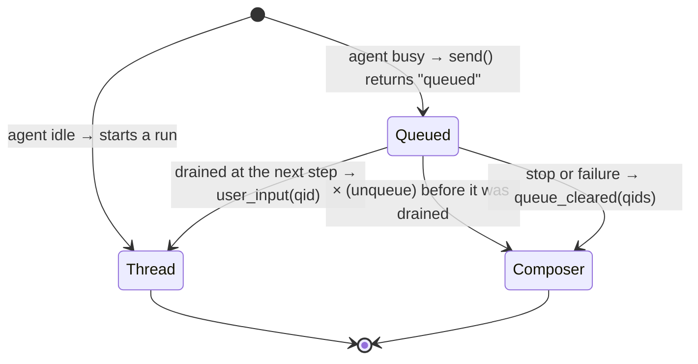
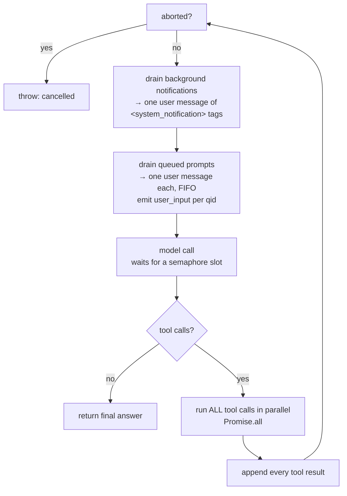
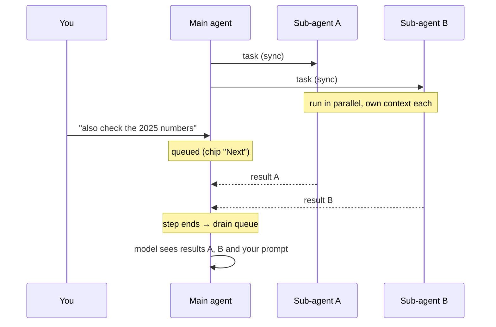

# The prompt queue: sending while the agent is working

You can keep typing while the agent works. This works the same way as in GitHub Copilot. This document explains what happens to a prompt you send while the agent is busy: running tools, running sub-agents in parallel, or waiting on a shell command. It covers where the prompt waits, when the model sees it, how it stays in sync with work that is still running, and what happens on stop, failure or removal.

Source files: `src/engine/engine.ts` (`Session.send`, the queue), `src/engine/loop.ts` (`runLoop`, the injection point), `src/engine/manager.ts` (sub-agents, background notifications), `src/engine/semaphore.ts` (model-call concurrency), `src/main/index.ts` (`run`, IPC), `src/renderer/src/App.tsx` (queue chips). Tests: `tests/engine.test.ts`.

## 1. The idea in one paragraph

There is **one conversation per chat and one main agent working on it**. A prompt sent while that agent is busy is **not** handed to a second agent and does **not** interrupt anything. It goes into a per-chat FIFO queue. The main agent's loop checks that queue at exactly one place: **after all tool results of the current step are in, and before the next model call**. Queued prompts are added there as ordinary user messages, and the model reads them together with everything done so far. The model decides how to combine them. "Also do X" gets folded into the current work. "Stop, do Y instead" changes course at the next step.

## 2. The pieces

| Piece | Where | What it holds |
|---|---|---|
| `Session.busy` | engine | `true` while the main agent's run is in progress |
| `Session.queue` | engine | `[{ qid, content }]`: prompts (with attachments already turned into content parts) waiting to join the conversation, in arrival order |
| `qid` | renderer → engine | A random ID the renderer gives each prompt, so both sides can refer to the same queued prompt |
| `entries[agent].notifications` | `AgentManager` | Messages for an agent from its finished **background** sub-agents |
| `Semaphore(maxConcurrency)` | `AgentManager` | Limits concurrent **model calls** across the main agent and all sub-agents (default 4) |
| Queue chips | renderer | What you see above the message box: **Next**, **+1**, **+2**… with **×** to take a prompt back |

## 3. Lifecycle of a prompt

- **Agent idle:** `send()` puts the prompt in the queue, sets `busy`, and starts the loop. The loop drains the queue on its first step, so even a "direct" prompt goes through the same path.
- **Agent busy:** `send()` pushes `{qid, content}` and returns `{ status: 'queued' }` right away. Nothing else happens until the loop reaches its next step. The renderer shows a chip.
- **Drained:** the loop takes **every** queued prompt at once, appends each as its own `user` message in arrival order, and emits `user_input{qid}` for each. The renderer removes the chip and adds the prompt to the thread at the point where it entered the conversation, so the thread shows what the model actually saw, in that order.

## 4. Where a queued prompt enters: the step boundary

Each iteration of `runLoop` (one "step") does this:

Why this point and nowhere else:

- **The message order stays valid.** Providers require `assistant(tool_calls)` to be followed directly by one `tool` result per call. A user message dropped in between would break the request. At the top of a step every call has its result, so a user message is always legal there.
- **The model never sees half-finished work.** It always gets complete tool results plus the new prompt, and can reason about both together.
- **Nothing is interrupted.** Running tools, shells and sub-agents are never cancelled by a new prompt. Only **Stop** cancels (§7).

### How long can a prompt wait?

A prompt waits until the **current step** finishes. A step finishes when the model call **and every tool call it made** have returned (`Promise.all`). So the wait is as long as the slowest tool in that step:

| What the agent is doing | Does a queued prompt wait for it? |
|---|---|
| Streaming a model response | Yes, until the response ends (seconds) |
| Quick tools (read, grep, write) | Yes, briefly |
| `shell` in **sync** mode | Yes, until the command ends or hits its timeout (default 120 s, max 600 s) |
| `shell` in **async** mode | No. The tool returns after `initial_wait`; the shell keeps running in the background |
| `task` sub-agent in **sync** mode | Yes. The parent's step waits for the whole sub-agent run |
| Several `task` calls in one step (parallel sub-agents) | Yes, until **all** of them return. They run in parallel, so this is the slowest one, not the sum |
| `task` sub-agent in **background** mode | No. The tool returns an `agent_id` right away |
| `read_agent` with `wait: true` | Yes, until the sub-agent finishes or the wait times out (default 60 s, max 600 s) |
| A permission prompt or a question to you (`ask_user`) | Yes, until you answer. Your answer goes straight into that tool's result; it is **not** a queued prompt |

If a prompt is urgent and the agent is stuck in a long sync step, press **Stop** (§7) and send it again.

## 5. Synchronizing with work running in parallel

"Parallel" means three different things in the app. The queue interacts with each one differently.

### 5.1 Parallel tool calls in one step

When the model asks for several tools in one response, they all start together and the step ends when the last one returns. A queued prompt never lands between them. It enters after the whole batch, together with all of their results.

### 5.2 Sub-agents (sync and parallel)

- **Queued prompts go to the main agent only.** Sub-agents have their own separate context and never see them. A running sub-agent keeps working on its original instructions.
- To change what a sub-agent is doing, you tell the main agent. It acts on that at its next step: it can use the result differently, or start a new sub-agent with corrected instructions.
- Model calls from the main agent and all sub-agents share **one semaphore** (`maxConcurrency`, default 4). This limits load on the provider. It does not change when a queued prompt is drained.

### 5.3 Background sub-agents and the notification channel

Background work has a second, separate inbox: **notifications**.

- When a background sub-agent finishes, its manager entry pushes "Background agent X completed. Use read_agent…" onto its **parent's** `notifications`.
- **If the main agent is busy**, that notification is drained at the top of its next step, in the same place as queued prompts. **Notifications go first** (one user message wrapped in `<system_notification>` tags), **then your queued prompts** (one user message each). The model therefore reads "this work finished" before "here is what the user just asked".
- **If the main agent is idle**, `onBackgroundDone` fires `onIdleNotification`. The main process then calls `run(id)` with no prompt, which starts a short run whose only input is the notification. The chat shows as busy while that run is in progress, and anything you send during it is queued as usual.
- **If a notification arrives as a run is ending**, `send()` checks `hasPendingNotifications` after it clears `busy` and wakes itself again in a microtask, so no notification is left behind.
- Background sub-agents **survive the end of the parent's turn**, so they can still be running when you send your next prompt. They do **not** survive **Stop**.

### 5.4 Why no locks are needed

The engine runs on Node's single-threaded event loop. Each of `queue.push` (in `send`), `queue.splice(0)` (in `drainQueue`) and `queue.splice(i, 1)` (in `unqueue`) runs to completion without anything else running in between. The drain is synchronous and happens right before the model call. So a prompt is either fully in the queue or fully in the conversation, never both and never lost. Concurrency comes from awaiting I/O (model streams, shells, sub-agents), not from threads that share memory.

## 6. Edge cases and races

| Situation | What happens |
|---|---|
| A prompt arrives **while the final answer is streaming** | `runLoop` returns, but the outer driver is `do { runLoop } while (queue.length)`, so it loops again at once and drains the prompt. The prompt is never stranded, and `busy` stays `true` throughout. |
| Several prompts queued | All are drained in one step, in arrival order, as separate user messages. The model answers them together. |
| **×** on a chip (`unqueue`) | If the prompt is still in the queue it is removed and its text goes back into the message box. If it was already drained (race), `unqueue` returns `false`, the `user_input` event moves it into the thread, and nothing is restored. |
| Renderer and engine disagree about `busy` (the run ended a moment ago) | It doesn't matter: both paths go through the engine queue. If the renderer showed a chip but the engine was idle, the engine starts a new run, drains the prompt at once, and `user_input` turns the chip into a thread message. |
| You switch to another chat | Queues are kept per chat (keyed by session ID). Chips stay with their chat, and that chat's agent keeps draining them. |
| Prompt with attachments | Attachments are turned into content parts **before** queueing, so the queued prompt is self-contained and costs no extra work at drain time. |
| Auto-compact | Runs only before a **new** run starts from a prompt, never on a queued prompt in the middle of a run. Manual compaction is refused while a chat is busy. |
| Switching to Autopilot while a permission prompt is open | The open permission prompts for that chat are approved, and the step carries on. |
| App quits with prompts queued | The queue lives in memory and is lost. The conversation up to the last finished run is saved; history is saved when each run ends. |

## 7. Stop and failure

- **Stop** (`stop()` → `manager.cancelAll()`) aborts the main agent and **every** running sub-agent, sync and background. Open permission and `ask_user` prompts are answered with their cancel value (`deny` / empty) so the awaiting tools can unwind.
- **Failure** happens when a model call fails (connection errors, 5xx and 429 are retried once if nothing has streamed yet), or when the agent hits the max steps (`maxTurnsMain`, default 50).
- In both cases the engine:
  1. repairs the history, adding an `Error: cancelled` result for any tool call of the last step that has none, so the next request is valid;
  2. **clears the queue** and emits `queue_cleared{qids}`, because a prompt written for the state before the interruption may no longer make sense;
  3. clears `busy` and emits `agent_end`.
- The renderer puts the text of the cleared prompts **back in the message box**, joined by blank lines. Nothing is lost: review it and press Enter to send it as a fresh run.

## 8. Why not a second agent?

You could run a new prompt in parallel as its own agent. The design deliberately doesn't:

- A second agent would need its own copy of the context, so it costs more and doesn't know about work still in flight.
- Its file edits and shell commands could conflict with the first agent's.
- Follow-ups usually refer to the work in progress ("also…", "use the other table"). One conversation keeps that link.

If you really want independent work, **fork** the chat at a turn, or start a new chat.

## 9. Events, at a glance

| Event | From | Effect in the UI |
|---|---|---|
| `busy{true/false}` (push) | main process `run()` | Working indicator (Working… / spinner on the chat) |
| `user_input{qid}` | `Session.drainQueue` | Chip removed, prompt added to the thread at this point |
| `queue_cleared{qids}` | `Session.send` on stop or failure | Chips removed, their text put back in the message box |
| `agent_start` / `agent_end` | `AgentManager.spawn` | Sub-agent cards; background agents also show as tray chips while running |
| `permission` / `ask` (push) | gate / `ask_user` tool | A card the current step waits on (§4) |

Covered by tests in `tests/engine.test.ts`: queued prompts run after a final answer; stop clears the queue (`queue_cleared`); an idle main agent is woken by a finished background agent; stop cancels main and all running sub-agents.
