# Tutorial: getting started

A short tour of SuperTM Desktop, from first launch to moving chats between Macs. The screenshots come from a demo setup: one working folder (`demo-app`), two skills, and an OpenAI-compatible test endpoint.

1. [Add a working folder](#1-add-a-working-folder)
2. [Connect a model provider](#2-connect-a-model-provider): [Vertex AI example](#example-a-google-cloud-vertex-ai), [Azure OpenAI example](#example-b-azure-openai-or-azure-ai-foundry)
3. [Chat with the agent](#3-chat-with-the-agent), including [sub-agents](#example-split-work-across-sub-agents), [working with Excel](#work-with-excel) and [with Word and PowerPoint](#work-with-word-and-powerpoint)
4. [Skills and agents per folder](#4-skills-and-agents-per-folder), including [turning a chat into a skill pack](#turn-a-chat-into-a-skill-pack)
5. [Keep long chats small: memory compaction](#5-keep-long-chats-small-memory-compaction)
6. [See what you spend: AI usage](#6-see-what-you-spend-ai-usage)
7. [Move chats between Macs: Sync sessions](#7-move-chats-between-macs-sync-sessions)
8. [Add tools with MCP servers](#8-add-tools-with-mcp-servers)
9. [Tune the limits (General settings)](#9-tune-the-limits-general-settings)
10. [Which version am I running?](#10-which-version-am-i-running), including [the update banner](#updating-to-a-newer-release)
11. [Keyboard shortcuts](#11-keyboard-shortcuts)

---

## 1. Add a working folder

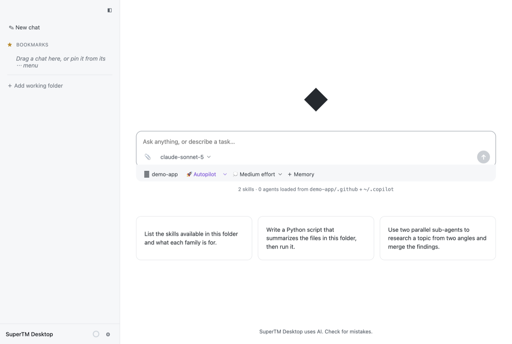

- Click **＋ Add working folder** in the sidebar and pick a folder. Chats are grouped under the folder they run in.
- The agent works inside that folder. It reads skills, agents and instructions from the folder's `.github/` and from your personal `~/.copilot/`.
- **✎ New chat** starts a chat in the current folder. Use **New chat in this folder** on a folder row to pick another one.
- **Bookmarks**: drag a chat onto *Bookmarks*, or pin it from its **⋯** menu, so you can find it fast.

## 2. Connect a model provider


1. Open **⚙ Settings** (bottom of the sidebar), then **Model providers**.
2. Click **＋ Add provider** and choose **Google Vertex AI**, **Azure OpenAI** or **Custom endpoint** (any OpenAI-compatible `/v1`).
3. Fill in the fields, press **Test**, then **Save**.

You can add more than one provider. The **primary** provider's models show by plain name; other providers' models show as `provider::model`. Use **Make primary** to switch. Existing chats keep the provider they started on. Keys are encrypted with the macOS keychain and stay on this Mac.

Two complete examples follow: [A. Google Vertex AI](#example-a-google-cloud-vertex-ai) and [B. Azure OpenAI](#example-b-azure-openai-or-azure-ai-foundry).

### Example A: Google Cloud Vertex AI


**Once per project (admin).** Turn on Vertex AI, create a service account, and give it permission to call models:

```bash
PROJECT=my-gcp-project
SA=supertm@$PROJECT.iam.gserviceaccount.com

gcloud services enable aiplatform.googleapis.com monitoring.googleapis.com --project $PROJECT
gcloud iam service-accounts create supertm --project $PROJECT --display-name "SuperTM Desktop"
gcloud projects add-iam-policy-binding $PROJECT --member serviceAccount:$SA --role roles/aiplatform.user
gcloud projects add-iam-policy-binding $PROJECT --member serviceAccount:$SA --role roles/monitoring.viewer  # optional: AI usage → Project tab
```

In **Model Garden**, enable the partner models you want (Claude, GLM, gpt-oss, …).

**Once per user.** Create a key file and keep it private:

```bash
mkdir -p ~/.config/supertm
gcloud iam service-accounts keys create ~/.config/supertm/sa-key.json --iam-account $SA
chmod 600 ~/.config/supertm/sa-key.json
```

No key files allowed? Leave the key path empty and run `gcloud auth application-default login` once instead.

**In the app:** **＋ Add provider → Google Vertex AI**, then fill in:

| Field | Example |
|---|---|
| GCP project | `my-gcp-project` |
| Default location | `global` (use a region like `us-east5` for regional models) |
| Service-account key | `~/.config/supertm/sa-key.json` (only the path is saved) |
| Models | one per line, as below |
| Vision model | `google/gemini-3.8-flash` |
| Claude prompt cache | `5 minutes (default)` |

```text
anthropic/claude-sonnet-5
anthropic/claude-opus-5 @us-east5     # @region overrides the location for this model
google/gemini-2.5-pro
google/gemini-3.8-flash
openai/gpt-oss-120b-maas describe     # describe = text-only; images go through the vision model
zai-org/glm-5.2-maas describe
```

Press **Test**. You should see `✓ 6 models`. A `403` means the service account is missing `roles/aiplatform.user`. A `404` for one model means it is not enabled in Model Garden, or it is not served in that location; add `@region`.

### Example B: Azure OpenAI (or Azure AI Foundry)

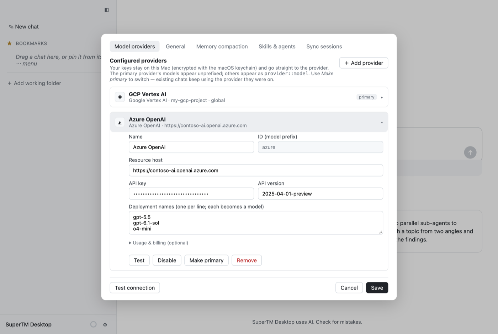

**In Azure.** Open your Azure OpenAI or AI Foundry resource:
1. Under **Keys and Endpoint**, copy the endpoint `https://<resource>.openai.azure.com` and **Key 1**.
2. Under **Deployments**, note the **deployment names**. The app calls these names, not the model names.

You can also get them with the Azure CLI:

```bash
az cognitiveservices account deployment list -g <resource-group> -n <resource> -o table
az cognitiveservices account keys list -g <resource-group> -n <resource> --query key1 -o tsv | pbcopy
```

For a Foundry project URL (`ai.azure.com/…/<subscription>,<resource-group>,,<resource>,<project>/…`), the host is still `https://<resource>.openai.azure.com`.

**In the app:** **＋ Add provider → Azure OpenAI**, then fill in:

| Field | Example |
|---|---|
| Resource host | `https://contoso-ai.openai.azure.com` |
| API key | Key 1 (encrypted with the macOS keychain) |
| API version | `2025-04-01-preview` |
| Deployment names | `gpt-5.5`, `gpt-6.1-sol`, `o4-mini` (one per line) |

**Save**, then send a short prompt to each deployment. Azure has no call to list deployments, so **Test** only checks the host. Unless Azure is the primary provider, its models show as `azure::<deployment>`. Models that only support the Responses API (for example `gpt-6.1-sol`) are switched to it automatically.

**Optional: see Azure cost in AI usage.** Open **Usage & billing (optional)**:

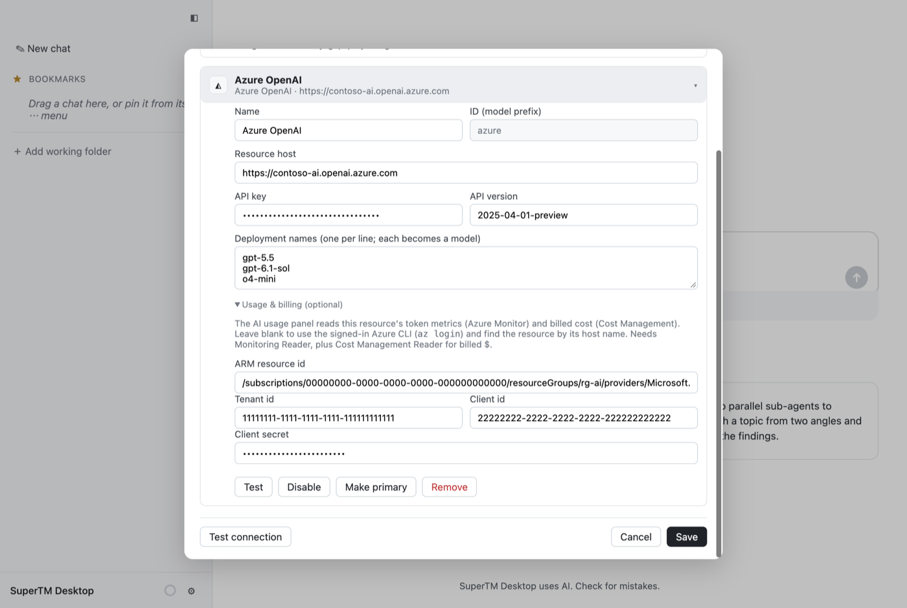

- **Sign-in:** leave the fields blank to use `az login`. To use a service principal, fill in **Tenant id**, **Client id** and **Client secret**.
- **ARM resource id:** leave it blank to find the resource by its host name, or paste it from the portal's **JSON View**.
- **Roles:** the identity needs **Monitoring Reader** on the resource for token counts. Add **Cost Management Reader** on the resource group to see billed $.

```bash
az ad sp create-for-rbac -n supertm-usage --role "Monitoring Reader" \
  --scopes /subscriptions/<sub>/resourceGroups/<rg>/providers/Microsoft.CognitiveServices/accounts/<resource>
az role assignment create --assignee <appId> --role "Cost Management Reader" \
  --scope /subscriptions/<sub>/resourceGroups/<rg>
```

More detail and troubleshooting for every provider kind: see [provider-setup.md](provider-setup.md).

## 3. Chat with the agent

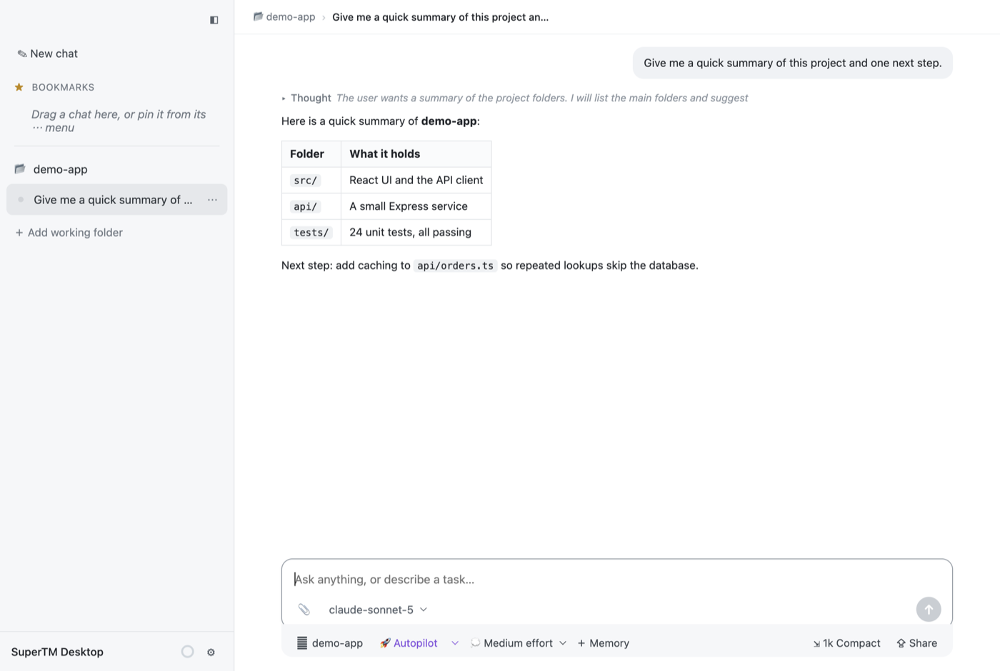

Type in the box at the bottom and press **Enter** (**Shift+Enter** adds a new line). From the bar under the box you can:

| Control | What it does |
|---|---|
| **Model** (e.g. `claude-sonnet-5`) | Pick the model for this chat |
| **📎** / paste / drop | Attach files and screenshots. Images get downscaled and documents trimmed to save tokens. Also lists the workbooks open in Excel, the documents open in Word and the presentations open in PowerPoint (see [Work with Excel](#work-with-excel) and [Work with Word and PowerPoint](#work-with-word-and-powerpoint)). |
| **Folder** (e.g. `demo-app`) | The working folder the agent runs in |
| **✋ Interactive / 🚀 Autopilot** | Interactive asks before running tools that change things. Autopilot runs them without asking. |
| **💭 Effort** | How much the model thinks before it answers (off, low, medium, high) |
| **＋ Memory** | Session memory for this chat only: free-text notes and/or attached `.md` files (e.g. a shared chat export) |
| **🗂 Folder memory** | Shows when the working folder has folder memory. Click it to edit (see below). |
| **⇲ Compact** | Shows the estimated context size. Click it to compact the history (see §5). |
| **⇪ Share** | Export this chat as raw Markdown, or turn it into a skill pack (see [§4](#turn-a-chat-into-a-skill-pack)) |

- **Thought** blocks show the model's reasoning. Click one to expand it.
- Tool calls and sub-agents show inline while they run. You can keep typing; new prompts queue up behind the current turn.
- Hover over a turn to **fork** a new chat from that point. The fork is filed under the original chat.

### Example: split work across sub-agents

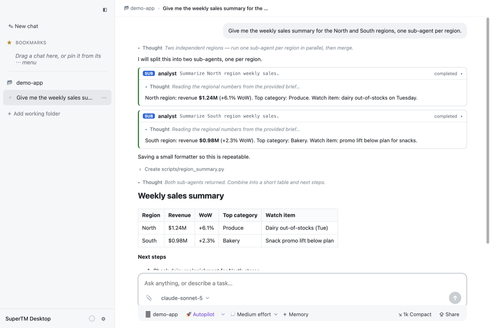

Ask for work that splits naturally and the main agent can hand each part to a **sub-agent**. Each sub-agent starts with a fresh context, works on its own, and returns one answer.

Example prompt:

> Give me the weekly sales summary for the North and South regions, one sub-agent per region.

What you see:

1. A **Thought** block with the plan ("run one sub-agent per region in parallel").
2. One **SUB** card per sub-agent. The card shows the agent it used (here `analyst`, from `demo-app/.github/agents/analyst.agent.md`), the task it was given, its own thinking and its answer. A spinner shows while it runs, then **completed**. Click the header to fold it.
3. Tool rows such as **Create scripts/region_summary.py** for files the agent wrote. Click one to see the details.
4. The main agent's merged answer.

Sub-agents run in parallel, up to **Max concurrent model calls** in Settings → General (see [§9](#9-tune-the-limits-general-settings)).

### Find a turn in a long chat

- A **rail of tick marks** on the right edge of the chat has one tick per prompt. The blue tick is the turn you are reading. Hover a tick to see the prompt and the first line of the reply; click it to jump there.
- When you scroll past a prompt into its reply, the prompt stays **pinned at the top** of the chat. Click it to go back to the start of that turn.
- **⌥↑ / ⌥↓** jump to the previous / next prompt. (While the message box has text in it, these keep their usual text-editing meaning.)

### Folder memory: notes every chat in a folder shares

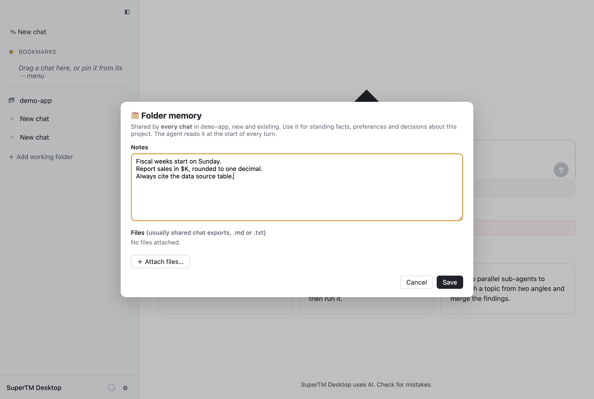

Right-click a working folder in the sidebar (or use its **⋯** button) and choose **Add folder memory…**. Write notes such as standing facts, preferences and decisions, and/or attach `.md` files. Every chat in that folder, new and existing, reads it at the start of each turn. A 🗂 icon marks folders that have memory.

- **Folder memory** is for the whole project. **Session memory** (＋ Memory) is for one chat. When both say different things, session memory wins.
- Folder memory is exported and imported with your chats. An import never overwrites folder memory you already have.

### Work with Excel

SuperTM can read and edit Excel workbooks directly, with no Excel add-in. A workbook that is **open in Excel** is edited in place: you watch the cells change and Excel recalculates. A **closed `.xlsx` file** is edited on disk. The screenshots below use a demo workbook, `Budget FY27.xlsx`, with 39 stores on a `Sales` sheet.

**1. Open the workbook in Excel and select the cells you care about.** Selecting is optional; it lets you say "these cells" in your prompt.

**2. In SuperTM, click 📎 and pick the workbook** under *Use a workbook open in Excel*.

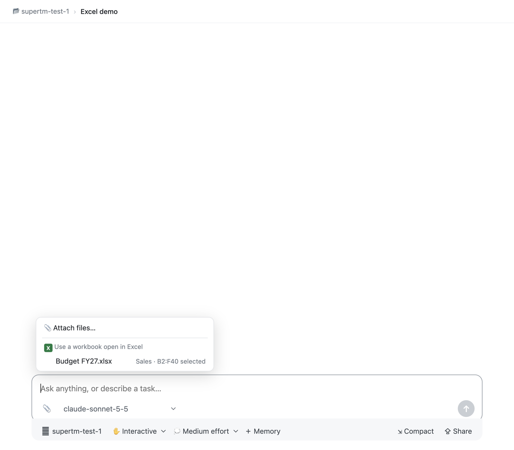

The first time, macOS asks whether SuperTM may control Microsoft Excel. Click **Allow**. If the menu says the permission is missing, turn it on in **System Settings → Privacy & Security → Automation**.

**3. Ask for what you want.** The green chip shows the workbook, a **Live** badge, and your current selection. SuperTM looks the selection up again when you press Enter, so you can change it in Excel after attaching.

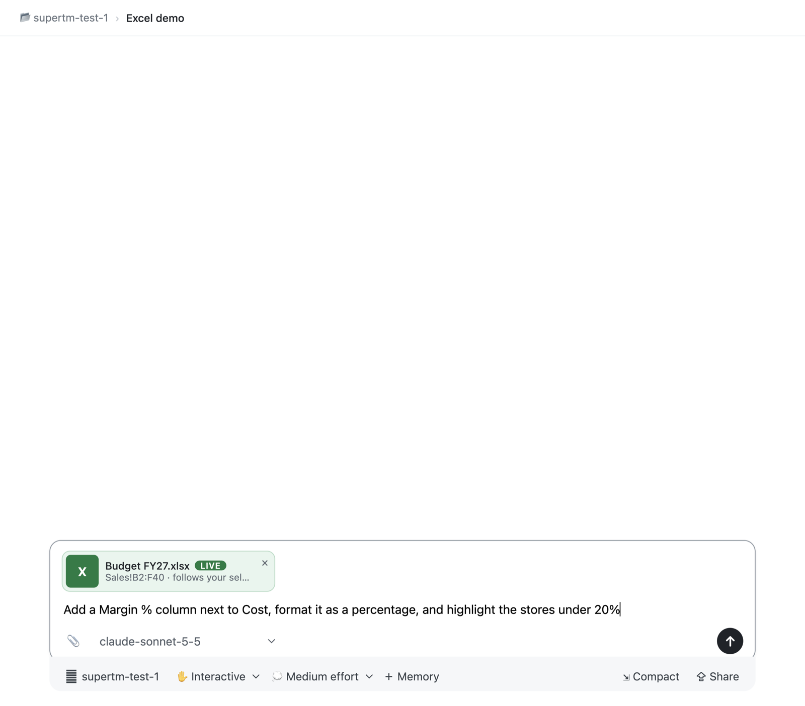

**4. Check the change and apply it.** In an **✋ Interactive** chat, SuperTM shows what it is about to write before it touches the workbook, including any cells it would replace.

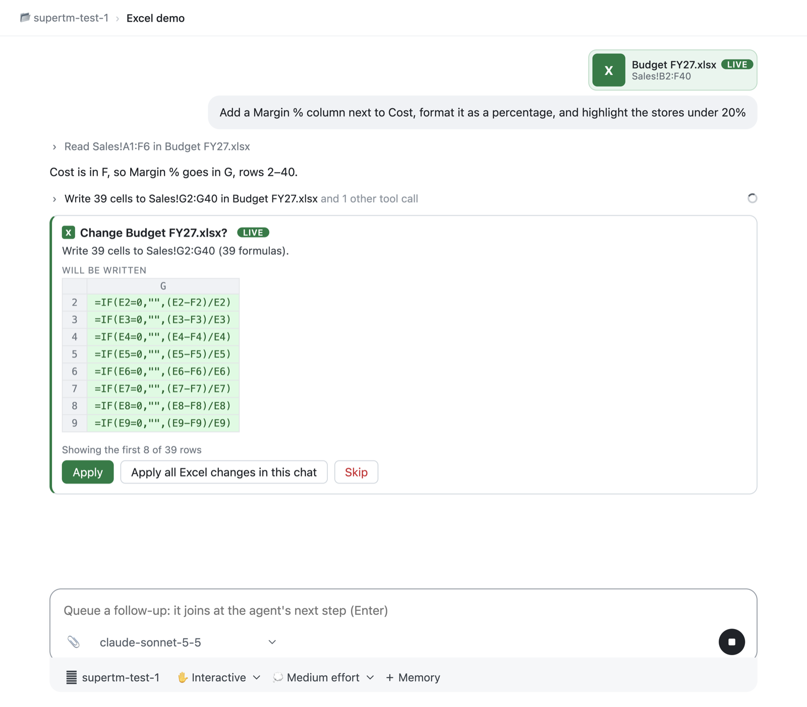

| Button | What it does |
|---|---|
| **Apply** | Makes this one change |
| **Apply all Excel changes in this chat** | Makes this change and stops asking for the rest of the chat |
| **Skip** | Leaves the workbook untouched and tells the agent you declined |

Reading cells never asks. In a **🚀 Autopilot** chat, changes are applied without asking.

**5. See what happened.** Each step shows as a plain line, such as "Write 40 cells to Sales!G1:G40". Click a line to see the cells.

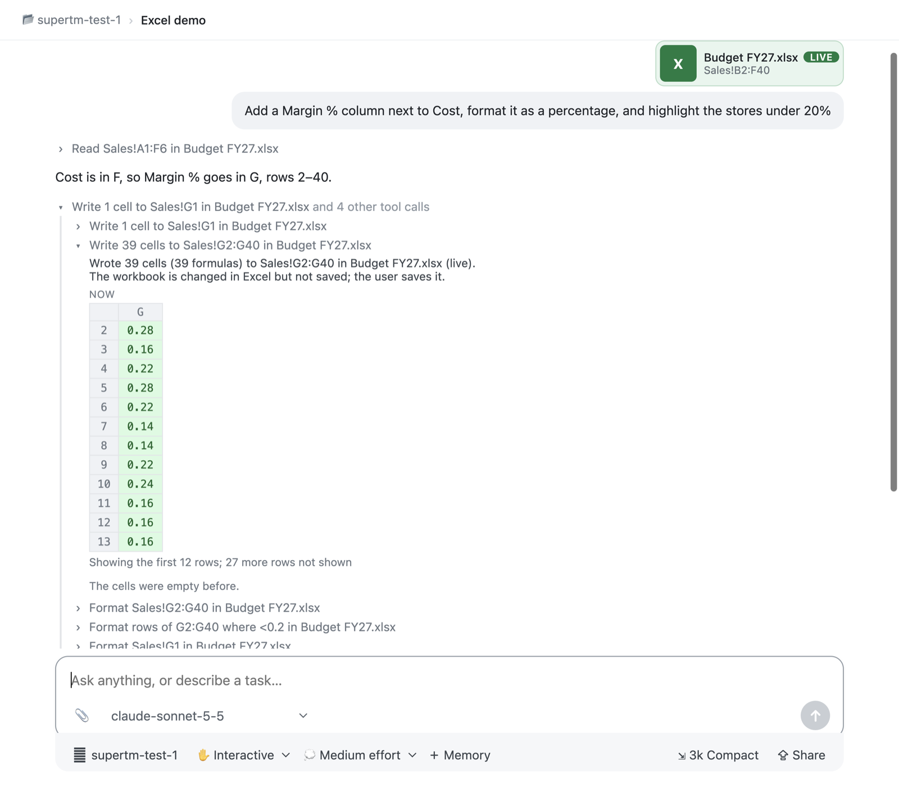

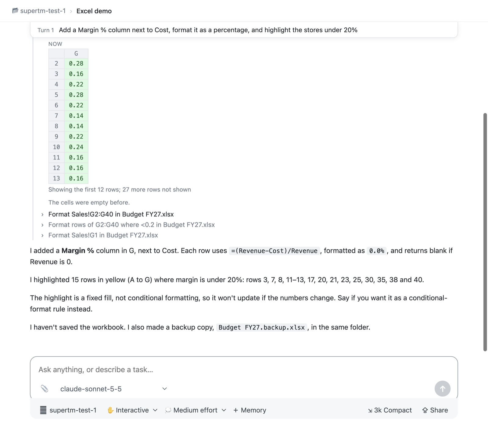

Things to know:

- **Nothing is saved for you.** A change to an open workbook stays unsaved until you save it in Excel.
- **A backup is made first.** Before its first edit, SuperTM copies the file to `name.backup.xlsx` next to it. For an open workbook this is the last saved version.
- **To undo**, ask SuperTM to "put it back": it keeps what the cells held before. Whether ⌘Z in Excel reverses these edits has not been tested, so don't rely on it.
- **Closed files work too.** Attach or drop an `.xlsx` (it gets a **File** badge), or just name it in your prompt. Formulas written to a closed file show their values once you open it in Excel.
- **Files with charts, pivot tables or macros** can only be edited while open in Excel. SuperTM refuses to edit them on disk, because that would drop those parts.
- **Highlighting is a plain fill.** "Highlight the stores under 20%" colours the cells that match now; it does not update when the numbers change.

The options are in **Settings → MS Office**, one tab for Excel, Word and PowerPoint: choose which apps the agent may use, connect to all of them with one button, choose whether to ask before changes, and turn backups off.

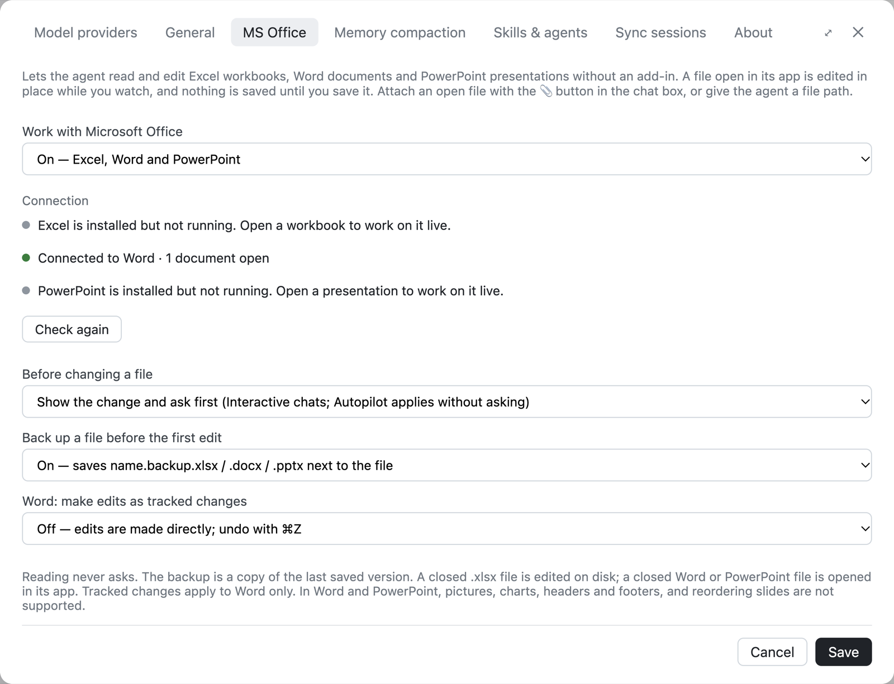

For how this works inside, see [Excel: how it works](excel.md).

### Work with Word and PowerPoint

SuperTM can also read and edit Word documents and PowerPoint presentations directly, with no add-in. The file is edited in place in Word or PowerPoint while you watch, and nothing is saved until you save it.

**1. Open the document or presentation**, then click 📎 and pick it under *Use a document open in Word* or *Use a presentation open in PowerPoint*. A chip with a **Live** badge shows the paragraph your cursor is in, or the slide on screen; it is looked up again when you press Enter, so you can move the cursor after attaching. You can also skip the chip and just name the file or give its path in your prompt (the app opens it for you).

**2. Ask in plain words.** For example: "Tighten the summary paragraph in Recap.docx", "Add a comment on the sales figure asking for the source", "Add a next-steps slide to the Q3 deck with these three bullets".

**3. Review each change.** In an ✋ Interactive chat a card shows the text as it is now and the text after the change. Choose **Apply**, **Apply all Word and PowerPoint changes in this chat**, or **Skip**. A 🚀 Autopilot chat applies without asking.

**4. Save in Word or PowerPoint when you are happy**, or undo with ⌘Z.

Good to know:

- **Tracked changes.** Settings → MS Office can make Word edits arrive as tracked changes you accept or reject.
- **Backup.** Before the first edit of a saved file, a copy of the last saved version is written next to it (`name.backup.docx` / `.pptx`).
- **You can keep typing.** If you change the same paragraph while the agent is working, it notices, makes no change, and reads again.
- **First use.** macOS asks once whether the app may control Word and PowerPoint. **Connect to Office** in Settings → MS Office connects to every Office app that is open, in one go.
- **Not supported:** pictures, charts, headers and footers, and reordering slides.

How it works inside: [office.md](office.md).

## 4. Skills and agents per folder


**Settings → Skills & agents** lists what each working folder loads:

- **A folder** (e.g. `demo-app`) shows skills from `<folder>/.github/skills/*/SKILL.md` and agents from `<folder>/.github/agents/*.agent.md`.
- **Personal** shows what is loaded from `~/.copilot/` for every folder.

The numbers next to each entry are *skills · agents*. To add a skill, put a folder with a `SKILL.md` under `.github/skills/` in the working folder. It shows up in the next chat. Details: [agent-framework.md](agent-framework.md).

### Turn a chat into a skill pack

When a chat worked out a task you will repeat, save it as a skill so the next chat can follow the same steps. Click **⇪ Share** under the chat box.

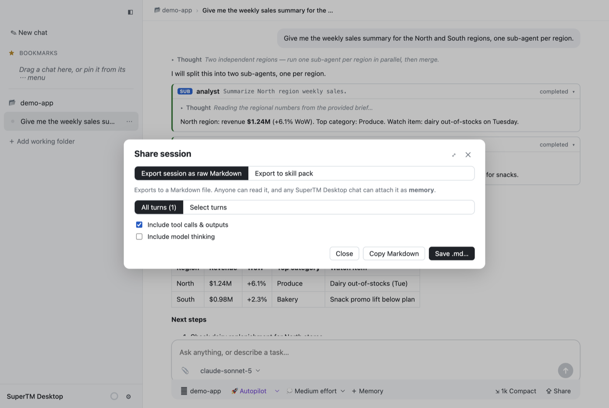

The dialog has two tabs:

- **Export session as raw Markdown** saves the chat (all turns, or the turns you select) to a `.md` file, or copies it. Tick **Include tool calls & outputs** and **Include model thinking** to keep those too. Anyone can read the file, and any chat can attach it as **＋ Memory**.
- **Export to skill pack** turns the chat into a reusable skill.

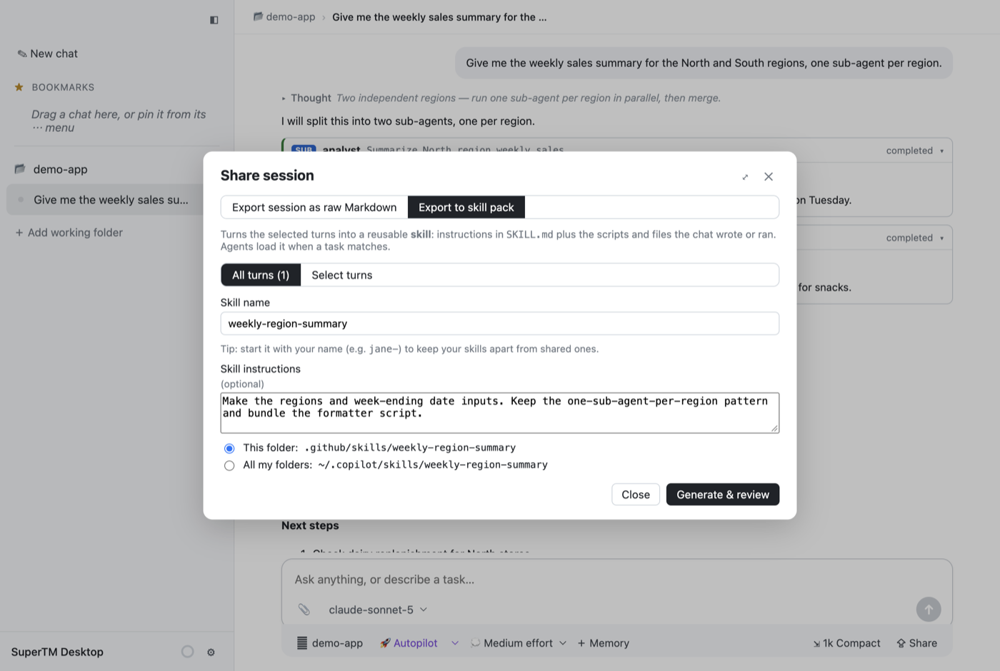

1. **Skill name.** Lowercase words joined by dashes, e.g. `weekly-region-summary`. Starting it with your name (e.g. `jane-`) keeps your skills apart from shared ones.
2. **Skill instructions** (optional). Tell the model how to codify the turns, for example: *"Make the regions and week-ending date inputs. Keep the sub-agent per region pattern and bundle the formatter script."*
3. **Where to save.** **This folder** puts it in `<folder>/.github/skills/<name>`; **All my folders** puts it in `~/.copilot/skills/<name>`.
4. Click **Generate & review**. A progress bar and timer show while the memory-compaction model drafts `SKILL.md` and collects the files:

   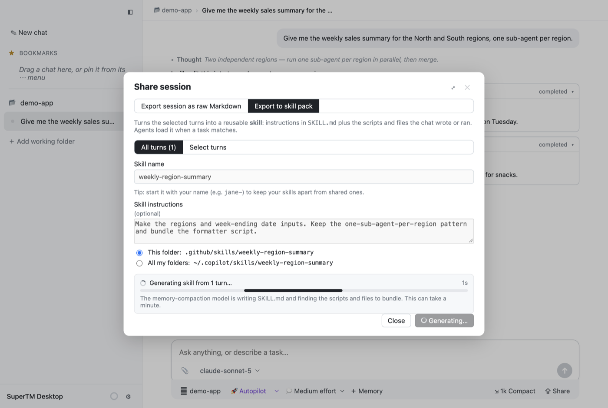

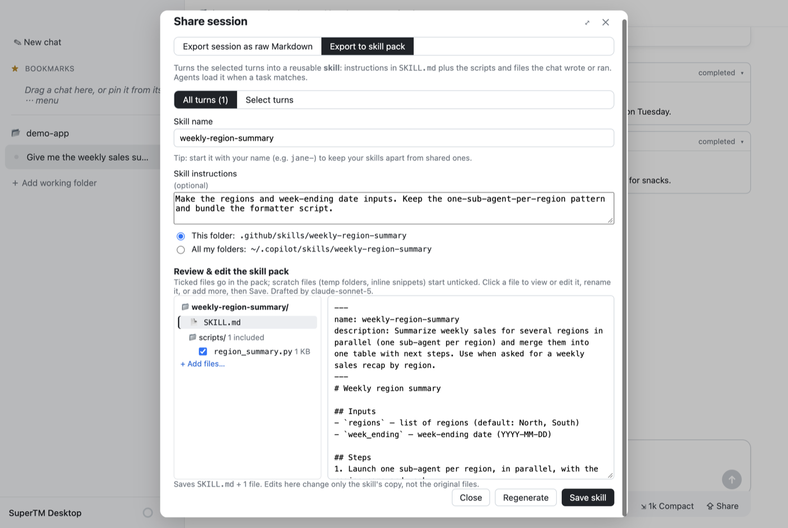

5. **Review & edit.** The left side is the skill folder as a tree: `SKILL.md`, then `scripts/` and `assets/` with the files the chat wrote or ran. Ticked files go into the pack; scratch files (temp folders, inline snippets) start unticked. Click any file to view or edit it on the right, rename it, or use **+ Add files…** to bring in more. Edits change only the skill's copy, never the original file.
6. Click **Save skill**. The app checks for secrets first, then writes the folder and shows **Show in Finder**. New chats in that folder can use the skill. **Regenerate** drafts it again, for example after you change the instructions.

## 5. Keep long chats small: memory compaction

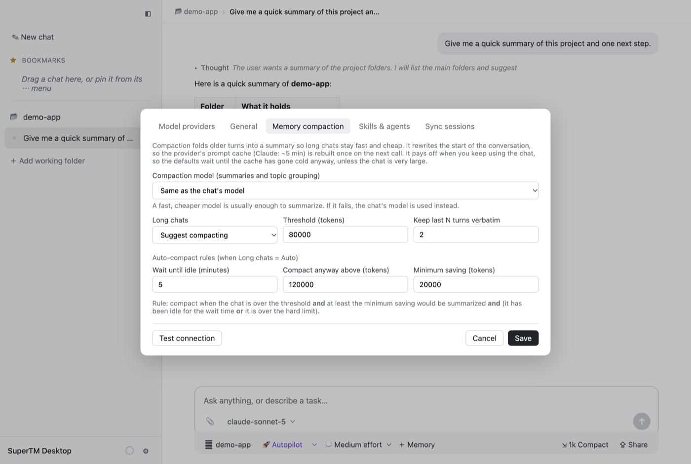

Compaction folds older turns into a summary so long chats stay fast and cheap.

- **By hand**: click **⇲ Compact** in the chat bar. Either keep the last *N* turns word-for-word, or **Choose turns** and set each turn (or a whole topic cluster) to *Keep · Summarize · Drop*.
- **Nothing is lost for good**: compacted turns stay in a searchable index. Ask about something from earlier ("what retry limit did we pick?") and the agent finds the turn with its `recall` tool, in this chat or other chats of the same folder. Name another chat in your prompt or in the session memory ("in the session Budget review, what did we decide about X?") and the agent searches that chat. With **Recall hints** on (Settings → Memory compaction), a short pointer to the matching turns is attached to your prompt automatically.
- **Automatically**: in **Settings → Memory compaction**, set *Long chats* to **Auto**. The rules wait until the provider's prompt cache has gone cold (it is idle for the wait time), unless the chat is over the hard limit. They also skip compactions that would save too little.
- **Compaction model**: choose a fast, cheaper model to write summaries. If it fails, the chat's model is used.

How it works: [context-memory.md](context-memory.md) (recall, recall hints, cross-chat recall and compaction).

## 6. See what you spend: AI usage


Open it with the **◯** button next to ⚙, or press **⌘⇧U**.

- **This app**: every model call this app made on this Mac (main agent and sub-agents), broken down by model and by chat, for *Today / 7 days / 30 days*.
- **Vertex project** / **Azure resource**: usage for the whole cloud project. These read from the cloud provider and need that provider set up (see [provider-setup.md](provider-setup.md)).
- **Cost** is a list-price estimate. Put a price table at `~/.supertm/pricing.json` (or set its path in **Settings → General**) to see dollars and not only tokens.

## 7. Move chats between Macs: Sync sessions

Every chat has a unique ID and a last-updated time, so chats can be copied between Macs safely. Open **Settings → Sync sessions**.

### Export


1. Click **⇪ Export sessions…** and choose a destination folder (a synced folder such as OneDrive or iCloud Drive works well).
2. All chats start selected, grouped in a folder tree. Uncheck whole folders or single chats you want to leave out. **Filter** narrows the list by title or folder.
3. Click **Export N sessions**.

### Import

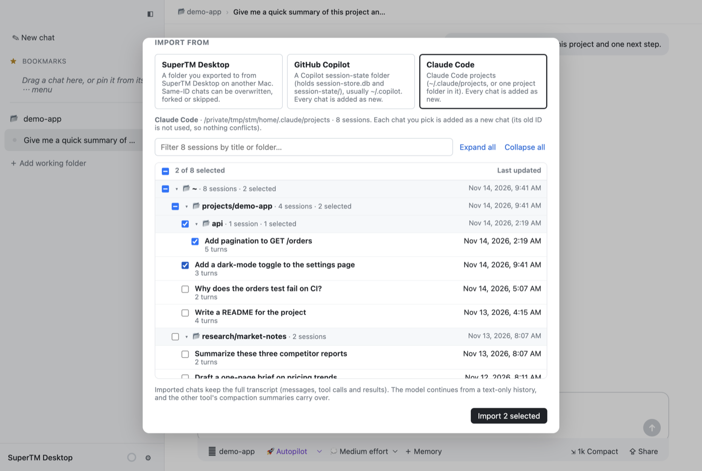

Pick where to import from:

| Source | Folder to choose | Same chat already here? |
|---|---|---|
| **SuperTM Desktop** | A folder you exported to on another Mac | You see how much newer or older each side is, then choose **Overwrite**, **Import as fork** (added under the local chat with a new ID) or **Skip** |
| **GitHub Copilot** | A Copilot `session-state` folder (has `session-store.db` and `session-state/`), usually `~/.copilot` | A chat you imported before is flagged **Imported before**, with how much newer the source is. Choose **Skip** (default), **Overwrite local** (replaces its history in place) or **Import as fork** |
| **Claude Code** | `~/.claude/projects`, or one project folder inside it | Same as GitHub Copilot |

Then:

1. Browse the tree. It is grouped by working folder; use **Expand all / Collapse all** or **Filter**.
2. Tick a folder to select everything in it, or tick single chats. The header shows how many are selected.
3. Under **Import into working folder**, choose one of your working folders, or **Choose another folder…**. Only the chats are imported, not the other Mac's folder path, so you never get a second folder with the same name. Chats that already exist here (**Overwrite** / **Import as fork**) stay in their current folder.
4. Click **Import N selected**. A progress bar shows how many chats are done (reading a large Copilot or Claude Code folder shows it too):

   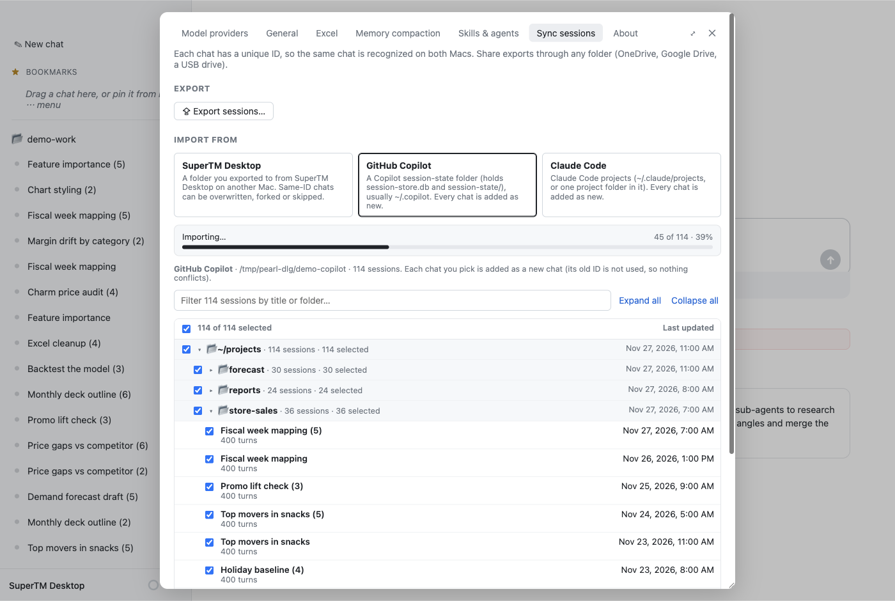

5. When it finishes, a summary replaces the list. The chats are in the sidebar under the folder you chose, with forks nested under their parent. Click **Import more from this source** to pick more chats from the same folder, choose another source above, or click **Close** at the bottom.

   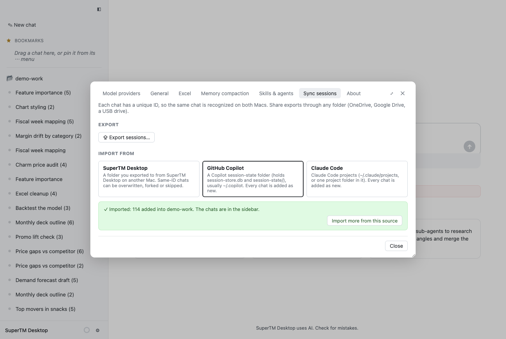

Imported chats keep the full transcript, including tool calls and results. The model continues from a text-only version of the history.

### Resize and close dialogs

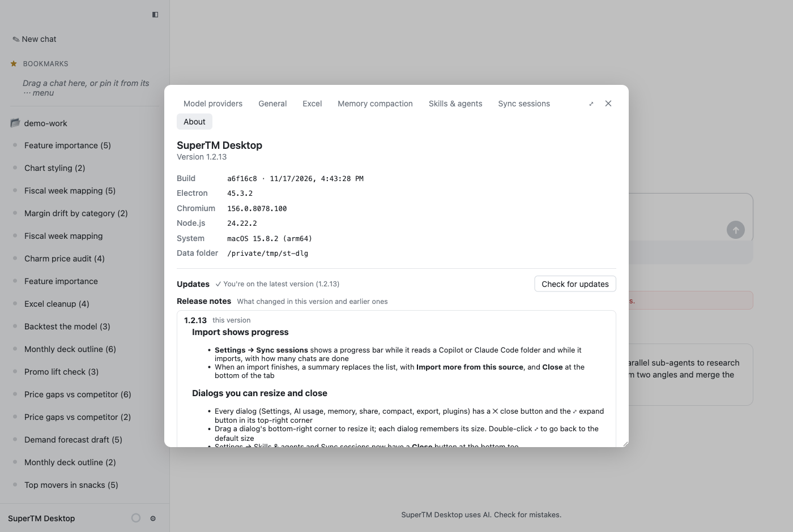

Every dialog (Settings, AI usage, memory, share, compact, export, plugins) has the same frame:

- **✕** (top right) closes it. **Esc** or a click outside also closes it; a drag that ends outside does not.
- **⤢ / ⤡** expands it to fill the window and shrinks it back.
- Drag any **edge or corner** to resize it. The size is remembered for that dialog; double-click ⤢ to go back to the default size.

## 8. Add tools with MCP servers

MCP (Model Context Protocol) servers give the agent extra tools, such as a company data service or a local program. Open **Settings (⚙) → MCP servers**.

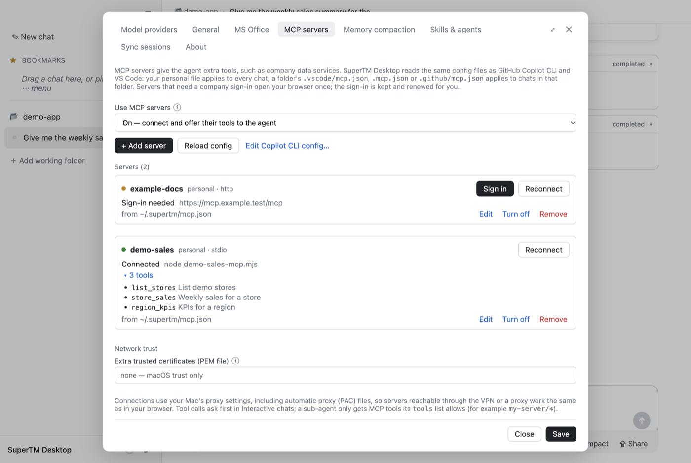

- **Use MCP servers** turns all of them on or off.
- Each server shows its state: a green dot and **Connected**, an amber dot and **Sign-in needed**, or a red dot with the error. **▸ N tools** lists the tools it offers.
- **Sign in** opens your browser for the company sign-in (for example your company's single sign-on). Sign in once; the app keeps and renews the sign-in for you.
- **Edit**, **Turn off** and **Remove** change one server. **Reconnect** retries it. **Reload config** rereads the files after you edit them by hand.
- The app reads the same files as GitHub Copilot CLI and VS Code: `~/.copilot/mcp-config.json` and `~/.supertm/mcp.json` for every chat (shown as *personal*), and a folder's `.vscode/mcp.json`, `.mcp.json` or `.github/mcp.json` for chats in that folder.

### Add a server

Click **+ Add server**. You can add as many as you need.

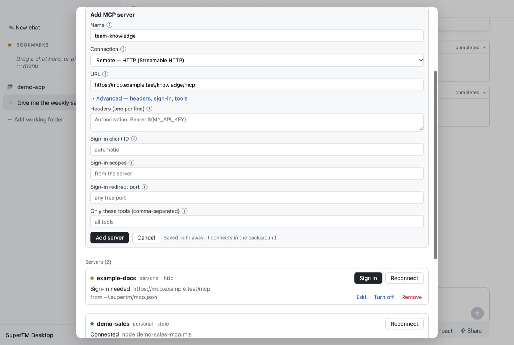

| Field | Example | Notes |
|---|---|---|
| **Name** | `team-knowledge` | Tools show to the model as `team-knowledge-<tool>` |
| **Connection** | Remote — HTTP | Remote HTTP (most servers), Remote SSE (older servers), or Local (a program on this Mac, started with a command) |
| **URL** | `https://mcp.example.test/knowledge/mcp` | For local servers you give a command and arguments instead |
| **Headers** | `Authorization: Bearer ${MY_API_KEY}` | Only for servers that use an API key; `${VAR}` reads an environment variable |
| **Sign-in client ID, scopes, redirect port** | blank | Leave blank unless the server's owner gives you values |
| **Only these tools** | `search, get_page` | Blank offers all of the server's tools |

Click **Add server**. It is saved right away and connects in the background. If the server needs a sign-in, your browser opens.

### Network trust

**Extra trusted certificates (PEM file)** adds certificates on top of the ones macOS trusts, for networks that inspect traffic. Connections use your Mac's proxy settings, including automatic proxy (PAC) files, so a server you can reach in the browser (on the VPN or through a proxy) works here too.

In Interactive chats, MCP tool calls ask first. A sub-agent only gets the MCP tools its agent file allows (for example `team-knowledge/*`).

## 9. Tune the limits (General settings)

**Settings (⚙) → General** holds the defaults for new chats and the limits on what the agent sends and reads. Every setting has an **ⓘ**: hover or click it for what it does and an example.

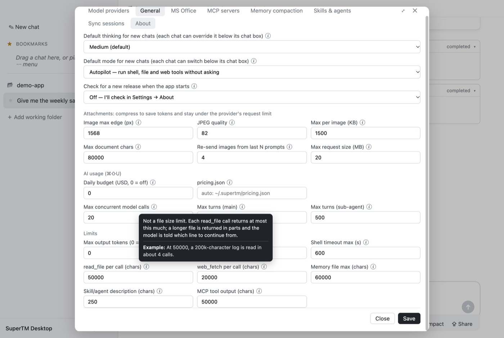

A few that people ask about:

| Setting | Default | What it means |
|---|---|---|
| **Max output tokens** | 0 | 0 lets each model write as much as it supports. Set a number to cap replies. |
| **Max concurrent model calls** | 20 | How many sub-agents (and other model calls) run at the same time |
| **Max turns (main / sub-agent)** | 500 / 500 | How many model steps one prompt may take before the agent stops |
| **read_file per call (chars)** | 50000 | Not a file size limit. A longer file is read in parts; the model is told where to continue. |
| **web_fetch / MCP tool output (chars)** | 20000 / 50000 | How much of one page or one MCP result goes back to the model |
| **Check for a new release when the app starts** | On | See [§10](#updating-to-a-newer-release) |

Click **Save** to apply. Changes take effect in the next prompt.

## 10. Which version am I running?

Open **Settings (⚙) → About**. It shows the app version, the build (git commit and build date), the Electron, Chromium and Node.js versions, macOS, and the data folder. **Copy version info** puts all of it on the clipboard for a bug report. The macOS menu **SuperTM Desktop → About SuperTM Desktop** shows the version and build too.

### Updating to a newer release

The **Updates** section under About checks the GitHub release list each time you open it, or when you click **Check for updates**. Every release newer than yours is listed, newest first, with its release notes, so you can decide whether to upgrade.

1. Click **Download *version***. The app downloads the macOS zip and checks that it is the version you picked.
2. Click **Restart to install *version***. The app quits, replaces itself in Applications, and reopens. Running chats stop; your chats, settings and keys are kept.
3. macOS asks once for keychain access. Choose **Always Allow**, or your saved keys show as blank until you do.

If the app can't replace itself (for example, it is not in a folder you can write to), About links to the release page so you can download the DMG instead.

The app also checks when it starts (turn this off in **Settings → General → Check for a new release when the app starts**). If a newer release exists, a banner shows at the top of the window:

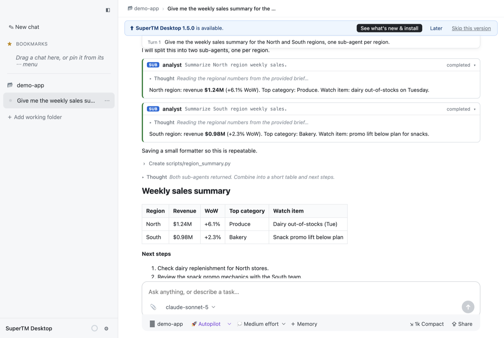

- **See what's new & install** opens About with the release notes and the **Download** button.
- **Later** hides the banner. The **⬆** next to ⚙ in the sidebar still shows that an update is waiting.
- **Skip this version** stops offering that version when the app starts. You are still told about newer ones, and About can install it any time.

## 11. Keyboard shortcuts

| Keys | Action |
|---|---|
| **Enter** / **Shift+Enter** | Send / new line |
| **⌘B** | Show or hide the sidebar |
| **⌘⇧U** | AI usage |
| **⌥↑ / ⌥↓** | Jump to the previous / next prompt in the chat |
| **⌘V** | Paste a screenshot or file as an attachment |
| **Esc** | Close the open dialog |
