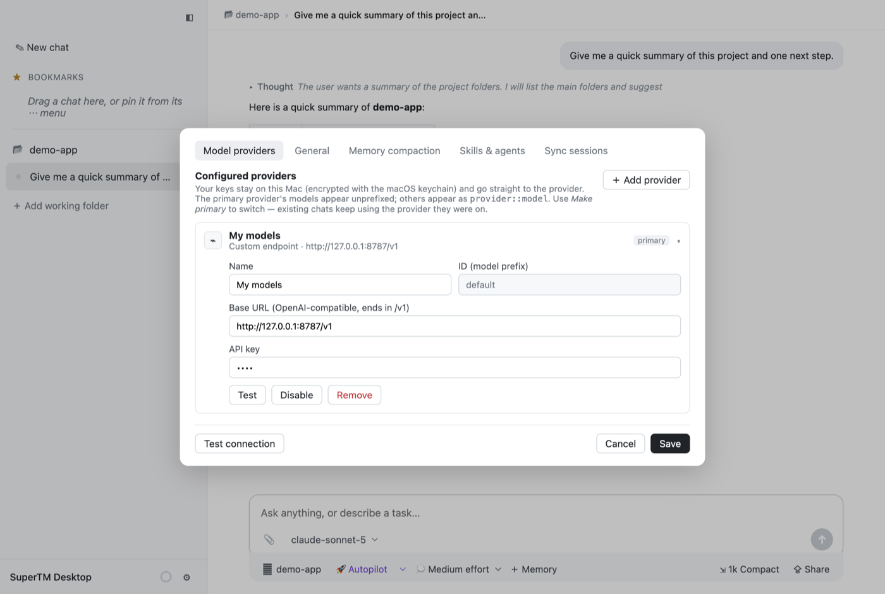
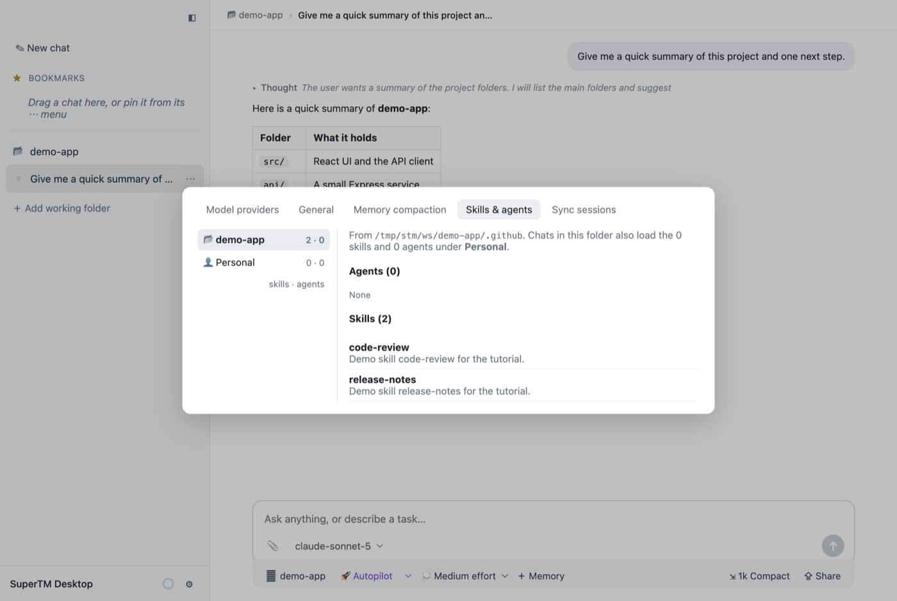
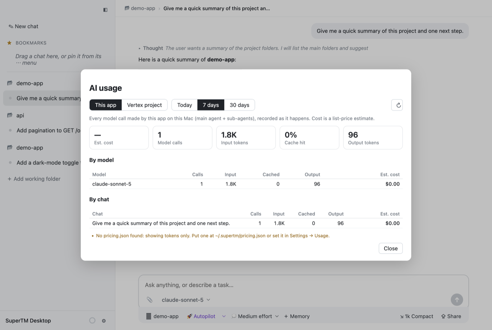
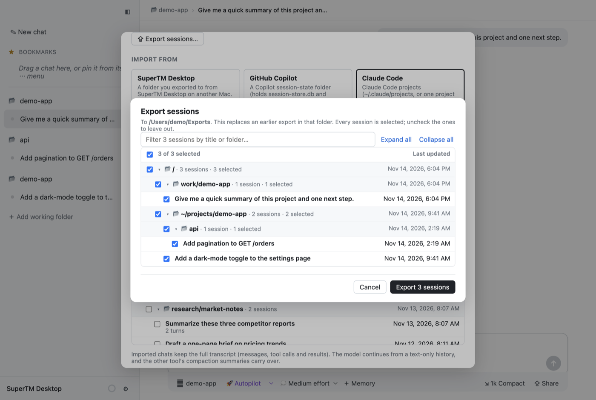

# Tutorial: getting started

A short tour of SuperTM Desktop, from first launch to moving chats between Macs. The screenshots come from a demo setup: one working folder (`demo-app`), two skills, and an OpenAI-compatible test endpoint.

1. [Add a working folder](#1-add-a-working-folder)
2. [Connect a model provider](#2-connect-a-model-provider)
3. [Chat with the agent](#3-chat-with-the-agent)
4. [Skills and agents per folder](#4-skills-and-agents-per-folder)
5. [Keep long chats small: memory compaction](#5-keep-long-chats-small-memory-compaction)
6. [See what you spend: AI usage](#6-see-what-you-spend-ai-usage)
7. [Move chats between Macs: Sync sessions](#7-move-chats-between-macs-sync-sessions)
8. [Keyboard shortcuts](#8-keyboard-shortcuts)

---

## 1. Add a working folder

- Click **＋ Add working folder** in the sidebar and pick a folder. Chats are grouped under the folder they run in.
- The agent works inside that folder. It reads skills, agents and instructions from the folder's `.github/` and from your personal `~/.copilot/`.
- **✎ New chat** starts a chat in the current folder. Use **New chat in this folder** on a folder row to pick another one.
- **Bookmarks**: drag a chat onto *Bookmarks*, or pin it from its **⋯** menu, so you can find it fast.

## 2. Connect a model provider

1. Open **⚙ Settings** (bottom of the sidebar), then **Model providers**.
2. Click **＋ Add provider** and choose **Google Vertex AI**, **Azure OpenAI** or **Custom endpoint** (any OpenAI-compatible `/v1`).
3. Fill in the fields, press **Test**, then **Save**.

You can add more than one provider. The **primary** provider's models show by plain name; other providers' models show as `provider::model`. Use **Make primary** to switch. Existing chats keep the provider they started on. Keys are encrypted with the macOS keychain and stay on this Mac.

Each provider kind is covered step by step in [provider-setup.md](provider-setup.md).

## 3. Chat with the agent

Type in the box at the bottom and press **Enter** (**Shift+Enter** adds a new line). From the bar under the box you can:

| Control | What it does |
|---|---|
| **Model** (e.g. `claude-sonnet-5`) | Pick the model for this chat |
| **📎** / paste / drop | Attach files and screenshots. Images get downscaled and documents trimmed to save tokens. |
| **Folder** (e.g. `demo-app`) | The working folder the agent runs in |
| **✋ Interactive / 🚀 Autopilot** | Interactive asks before running tools that change things. Autopilot runs them without asking. |
| **💭 Effort** | How much the model thinks before it answers (off, low, medium, high) |
| **＋ Memory** | Attach a shared chat export as prior memory |
| **⇲ Compact** | Shows the estimated context size. Click it to compact the history (see §5). |
| **⇪ Share** | Export this chat to Markdown |

- **Thought** blocks show the model's reasoning. Click one to expand it.
- Tool calls and sub-agents show inline while they run. You can keep typing; new prompts queue up behind the current turn.
- Hover over a turn to **fork** a new chat from that point. The fork is filed under the original chat.

## 4. Skills and agents per folder

**Settings → Skills & agents** lists what each working folder loads:

- **A folder** (e.g. `demo-app`) shows skills from `<folder>/.github/skills/*/SKILL.md` and agents from `<folder>/.github/agents/*.agent.md`.
- **Personal** shows what is loaded from `~/.copilot/` for every folder.

The numbers next to each entry are *skills · agents*. To add a skill, put a folder with a `SKILL.md` under `.github/skills/` in the working folder. It shows up in the next chat. Details: [agent-framework.md](agent-framework.md).

## 5. Keep long chats small: memory compaction

Compaction folds older turns into a summary so long chats stay fast and cheap.

- **By hand**: click **⇲ Compact** in the chat bar. Either keep the last *N* turns word-for-word, or **Choose turns** and set each turn (or a whole topic cluster) to *Keep · Summarize · Drop*.
- **Automatically**: in **Settings → Memory compaction**, set *Long chats* to **Auto**. The rules wait until the provider's prompt cache has gone cold (it is idle for the wait time), unless the chat is over the hard limit. They also skip compactions that would save too little.
- **Compaction model**: choose a fast, cheaper model to write summaries. If it fails, the chat's model is used.

How it works: [memory-compaction.md](memory-compaction.md).

## 6. See what you spend: AI usage

Open it with the **◯** button next to ⚙, or press **⌘⇧U**.

- **This app**: every model call this app made on this Mac (main agent and sub-agents), broken down by model and by chat, for *Today / 7 days / 30 days*.
- **Vertex project** / **Azure resource**: usage for the whole cloud project. These read from the cloud provider and need that provider set up (see [provider-setup.md](provider-setup.md)).
- **Cost** is a list-price estimate. Put a price table at `~/.supertm/pricing.json` (or set its path in **Settings → General**) to see dollars and not only tokens.

## 7. Move chats between Macs: Sync sessions

Every chat has a unique ID and a last-updated time, so chats can be copied between Macs safely. Open **Settings → Sync sessions**.

### Export

1. Click **⇪ Export sessions…** and choose a destination folder (a synced folder such as OneDrive or iCloud Drive works well).
2. All chats start selected, grouped in a folder tree. Uncheck whole folders or single chats you want to leave out. **Filter** narrows the list by title or folder.
3. Click **Export N sessions**.

### Import

Pick where to import from:

| Source | Folder to choose | Same chat already here? |
|---|---|---|
| **SuperTM Desktop** | A folder you exported to on another Mac | You see how much newer or older each side is, then choose **Overwrite**, **Import as fork** (added under the local chat with a new ID) or **Skip** |
| **GitHub Copilot** | A Copilot `session-state` folder (has `session-store.db` and `session-state/`), usually `~/.copilot` | Not possible; every chat is added as new |
| **Claude Code** | `~/.claude/projects`, or one project folder inside it | Not possible; every chat is added as new |

Then:

1. Browse the tree. It is grouped by working folder; use **Expand all / Collapse all** or **Filter**.
2. Tick a folder to select everything in it, or tick single chats. The header shows how many are selected.
3. Click **Import N selected**. Imported chats appear in the sidebar under their working folder.

Imported chats keep the full transcript, including tool calls and results. The model continues from a text-only version of the history.

## 8. Keyboard shortcuts

| Keys | Action |
|---|---|
| **Enter** / **Shift+Enter** | Send / new line |
| **⌘B** | Show or hide the sidebar |
| **⌘⇧U** | AI usage |
| **⌘V** | Paste a screenshot or file as an attachment |
| **Esc** | Close the open dialog |
